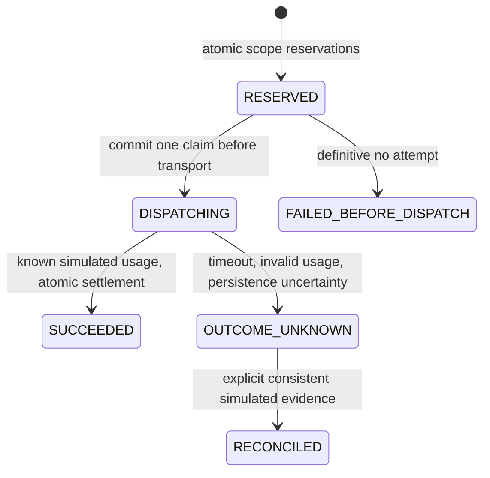
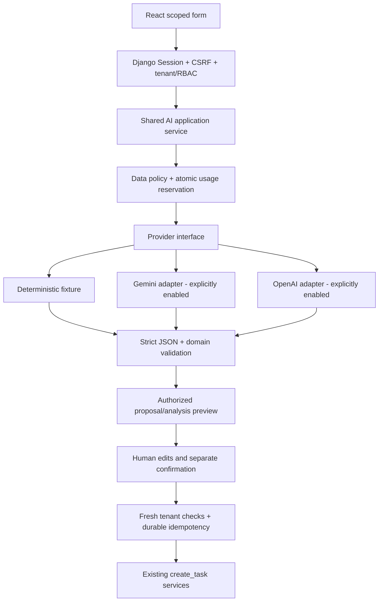

# HT-AI-P4-01 — AI Architecture, Provider Selection & Security Design

Ngày: **2026-10-28**. AI01 design complete; Owner đã duyệt v1 fixture-only cho
P4-02B. Live/provider/private-data decisions ngoài phạm vi vẫn pending.

## HT-AI-P4-04C — Durable governance, offline implementation (2026-11-08)

**OFFLINE GOVERNANCE IMPLEMENTATION READY / DEVELOPMENT MIGRATION PENDING.**
The Owner authorizes candidate additive schema and isolated PostgreSQL tests,
not development apply, live data/billing or production. This section supersedes
04B's proposed governance structure for the implemented offline slice only.
Provider choice still targets the existing gpt-5.4-mini Responses adapter;
there is no live transport, automatic fallback or key lookup.

### Source-backed risk and actual new boundary

Existing AiOperation/confirmation locks prevent repeated Task creation after
proposal confirmation. They do not reserve a billable dispatch before two
workers enter provider generation. The process-local HTTP throttle cannot be
the shared spending authority. Reusing old operation statuses would obscure
the difference between no dispatch and a possibly charged unknown result.

New [governance.py](../backend/apps/ai/governance.py) and three appended
[models](../backend/apps/ai/models.py) implement that separate boundary:

1. Fail closed before candidate-table SQL unless literal AI_GOVERNANCE_ENABLED,
   enabled trusted GovernancePolicy and existing development fixture guard pass.
   No setting/env loader was added; OPENAI_LIVE always fails closed.
2. Revalidate current manager actor/Profile/Workspace and resolve real selected
   Review/Comment sources for Analyzer. No client DTO grants authority.
3. In a short atomic transaction lock existing tenant context, then stable
   GLOBAL/Profile/User buckets, then dispatch/reservations. Check shared
   simulated cost exposure/request/inflight caps and reserve all three or none.
4. Match scoped key plus keyed input/policy fingerprints. An equivalent request
   returns metadata; changed input/config/rates/identity conflicts. Exactly one
   RESERVED→DISPATCHING claim commits before the unchanged fake adapter runs.
5. Run fake transport outside database locks, then settle known simulated usage
   once or retain uncertain holds. No Task/proposal/analysis-history creation.



DISPATCHING also preserves uncertainty if a crash/database outage prevents an
UNKNOWN write. No expired lease, cancellation or worker restart proves no charge.
There is no transition back to RESERVED, automatic refund or redispatch. The
original actor must retain current authority to read/reconcile; revocation
leaves holds intact for a future approved operator workflow.

### Persistence, provenance and accounting

Candidate [ai.0002_dispatch_governance](../backend/apps/ai/migrations/0002_dispatch_governance.py)
creates AiDispatch (scope/mode/identity/lifecycle/nullable usage and distinct
reservation/estimated/accounted/billed amounts), AiBudgetBucket (shared limits
and counters) and AiDispatchReservation (three protected holds). No old-table
alteration/backfill or fixture provenance rewriting. Detailed constraints,
lock order and reconciliation rules are in [AI_PERSISTENCE_REVIEW](AI_PERSISTENCE_REVIEW.md)
and [DATABASE_SCHEMA](DATABASE_SCHEMA.md).

FIXTURE, OPENAI_OFFLINE and OPENAI_LIVE are distinct schema modes. Only offline
fake execution is implemented here; generated_by_ai stays false. Fake usage is
SIMULATED, missing usage UNKNOWN, estimated debit is not actual billing and
billed_cost remains NULL. Future observed provider usage and billing records
must be separately validated; their schema capacity is not an implementation.

Body/policy/evidence fingerprints are purpose-separated HMACs with verified
scope and Django fallback-key support. Brief, source text/focus, provider bodies
and derived result text are not persisted by this ledger. A first success can
return transient validated output; duplicates return the receipt without
redispatch or saved-output recovery. Existing fixture routes, AiProposal storage,
human confirmation and advisory-only stateless Analyzer are unchanged. No new
public API/React fields, runtime setting or signal side effect is introduced.

Bucket identity is scope+mode, independent of date/model/config. Current limits
are lifetime/cumulative; a new model/date never creates a fresh global allowance
or loses old unknown holds. All default cost/request/inflight caps are zero;
simulation policy is trusted server configuration, not request input. The
synthetic reservation is ceiling((input cap×input rate +output cap×output rate)
/1,000,000) to8 decimal places. These configured offline caps/rates are not a
tokenizer-proven upper bound or current published live price. Unknown/out-of-cap
usage keeps reservations; provider billing limits/monitoring are still required.
No absolute prevention of live charges is claimed from database controls alone.

### Verification and remaining gates

Final focused52/52 PASS15.286s includes two real PostgreSQL connection races
and6 migration tests (empty/legacy-related chain, constraints/indexes/relations).
Full isolated826/826 PASS231.558s covers existing AI/business regressions.
Both launchers and actual Python exit0; pip/Django/model graph/full migration
chain and owned cleanup verified. Frozen source and29-table read-only development
comparison are exact; development36 migrations/4 Users/2 Sessions preserved,
candidate0002 UNAPPLIED. Failed synthetic-fixture setup attempts and all current
evidence are recorded in [HANDOVER](HANDOVER.md), not relabeled as passing runs.
No frontend/browser/live provider suite was executed for this backend-only slice.

Remaining work is staged: no live billing evidence, automatic budget reset,
operator recovery, proposal/result persistence integration, public contract or
network client. Simulated reconciliation relies on a trusted caller assertion,
not a verified invoice. Generic ORM hard-delete/AdminCollector maintenance may
query new PROTECT relations before rollout and is not safe on the old schema;
authorized current HTTP/fixture/startup paths do not execute new-table code.
No such development maintenance is authorized.

Next proposal: separately approved fresh inventory/backup and isolated restore
readiness for ai.0002; development apply requires another explicit safety gate.
Live HTTP/proposal wiring, private data terms, verified model bounds/pricing,
provider-side limits/monitoring and tightly budgeted live smoke need separate
Owner decisions. Manual website acceptance and the permanent deployment gate
remain. **Stop at HT-AI-P4-04C — OWNER REVIEW GATE.**

## HT-AI-P4-04B — Offline OpenAI adapter (2026-11-08)

Historical04B checkpoint; current04C governance status is recorded above.

**OFFLINE OPENAI ADAPTER COMPLETE — OWNER REVIEW GATE.** The Owner now
chooses OpenAI, `gpt-5.4-mini`, Responses API and strict Structured Outputs for
an actual offline adapter. This supersedes04A's provider-selection blocker for
the approved target, not its live data, provenance, cost or migration gates.
Execution remains fake transport only, live budgetUSD0. No key or live call.

Implemented [openai_adapter.py](../backend/apps/ai/openai_adapter.py), using the
existing StructuredProvider.generate(ProviderRequest,RequestControl)→ProviderResult
contract; no second provider framework. Existing FixtureAdapter, application
services, endpoints, React DTOs, models, migrations and settings are untouched.
The current HTTP application still deliberately rejects nonfixture adapters.

### Actual code boundary and configuration

OpenAIResponsesAdapter accepts OpenAIConfig and an explicitly injected
OfflineTransport.post(url,body,timeout_seconds,max_response_bytes,control).
TransportResponse carries status_code and bounded bytes. No SDK, HTTP client,
network implementation, credential/header loader, env reader, ORM or logging
call exists in this module. A default instance cannot dispatch. Config.enabled
must explicitly be True and the trusted in-memory transport's offline marker
must literally be True. This is offline execution enablement, not live activation.
Key presence in environment cannot construct or activate a network transport.

| Config | Default | Enforced bound |
|---|---|---|
| enabled |false|exact bool; false→AI_DISABLED without transport call|
| model |gpt-5.4-mini|server-code-owned bounded identifier; exact configured response model checked|
| timeout_seconds |30.0|finite positive,≤120 seconds; effective deadline also respects RequestControl|
| max_output_tokens |4096|exact integer1..32768, including reasoning/output budget|
| max_response_bytes |131072|exact integer1..1048576 for provider envelope; domain JSON remains≤65536|

Outbound envelope is capped at65536 UTF-8 bytes, enough for the existing12000
character source budget with multibyte text plus schema. Input/domain limits
remain unchanged: Generator brief6000 chars, total plan20 nodes/3 child levels,
Analyzer1..20 selected sources/12000 text chars/focus1000, strict enums/dates and
response fields. These offline technical caps are not an approved live budget.
No settings.py or .env.example variable is introduced or read.

### Request, response and privacy mapping

The canonical endpoint metadata is https://api.openai.com/v1/responses, passed
only to the fake transport. Body uses explicit model, store:false, stream:false,
tools:[], max_output_tokens, separated system and JSON user-data messages, and
text.format:{type:json_schema,name,strict:true,schema}. Every schema object has
additionalProperties:false and all declared fields required. Graph/cycle/depth,
date validity and citation membership are still checked by existing domain
validators after parsing; a provider schema cannot establish tenant authority.

Generator projects only validated brief and explicit permitted time context;
no current date, user assignment, status or tenant is invented. System guidance
requires null/warnings for deadlines lacking evidence. Offline tests prove that
guidance/validation, not that a real model interprets dates accurately.
Analyzer projects only authorized source correlation refs/text and focus.
FeedbackInput carries no actor: a local zero-UUID sentinel supplies only the
existing pure parser's unused actor-correlation slot. It is not a User, permission
grant or business mapping and is never sent/stored. Profile/Workspace/Task source
consistency is checked locally; future Django integration must still perform
actual authorization/source selection/revalidation before/after dispatch.

Response parsing requires object=response, completed status, no nonnull error/
incomplete_details, an accepted model and exactly one completed assistant text
message. The approved alias also accepts its officially documented snapshot
gpt-5.4-mini-2026-03-17. Tools/function calls, multiple messages, refusals,
truncation, malformed/duplicate/nonfinite JSON, byte overflow and invalid domain
fields/graph/citations fail safely. Reasoning metadata is ignored, never returned
or executed. Raw response/error bodies are not exposed or logged.

Return provenance is **provider=openai_offline**, usage.status=offline_simulated,
cost_usd=None. Optional fake token counts are validated as nonnegative exact
integers with consistent totals/detail bounds; absent usage stays unknown.
These are invented test observations, not actual inference or billable tokens.
Nothing is relabelled fixture_zero or published through current fixture React.
Raw brief, feedback and response remain transient; no AI/business record is
created and no retention guarantee beyond absence of persistence is asserted.

### Errors, timeouts and retries

| Case | Existing safe AIError classification |
|---|---|
| Disabled / transport not explicitly offline |AI_DISABLED|
| Missing transport, invalid model/config/input/control |VALIDATION_ERROR|
| Provider401/403 |PROVIDER_UNAVAILABLE; upstream credentials are not caller RBAC|
| Provider429 |RATE_LIMITED|
| Timeout / cooperative deadline |PROVIDER_TIMEOUT|
| Connection, other status, unexpected transport failure |PROVIDER_UNAVAILABLE|
| Refusal |AI_REFUSED|
| Invalid/incomplete/envelope/domain output |INVALID_PROVIDER_RESPONSE|
| Cooperative cancellation |CANCELLED|

No automatic retry, retry exhaustion loop, silent provider/model fallback or
fixture substitution exists. Effective timeout is the smaller of configured
timeout and remaining monotonic deadline; checked before/after transport and
validation. A synchronous injected callback must honor the timeout/control
contract; the adapter cannot forcibly preempt arbitrary Python or promise a
remote refund. A future timeout/disconnect never establishes zero provider cost.
The offline marker is a trusted-code seam, not a sandbox for malicious Python;
tests additionally guard network/file/DB/domain operations and use invented data.

### Verification and remaining activation gates

Focused new adapter55/55 PASS0.038 seconds; final apps.ai270/270 PASS13.347 seconds,
both launcher/actual Python exits0 and owned cleanup verified. Dependency/Django/
model/migration-chain checks pass. All245 original sources and the two tested
file hashes remain unchanged; final29-table development row/schema/sequence/
history/cluster comparison is exact (4 Users/36 migrations preserved). Current
evidence is in HANDOVER. No frontend/browser/live model test is implied by this
adapter check. Official model and output semantics were fetched2026-11-08:
[model](https://developers.openai.com/api/docs/models/gpt-5.4-mini),
[Structured Outputs](https://developers.openai.com/api/docs/guides/structured-outputs?api-mode=responses).
The API reference HTML exceeded tool limits and its Markdown was not rendered;
the official guide's Responses text.format semantics are implemented. No account
access, API key, live reliability, Vietnamese quality or billable integration is
verified. store:false is not a provider Zero Data Retention guarantee.

Adapter implementation can complete independently of live activation. The exact
Generator provenance/dispatch/accounting migration proposal is in
[AI_PERSISTENCE_REVIEW](AI_PERSISTENCE_REVIEW.md), not applied or approved schema.
Keep Analyzer stateless. Before paid wiring, review the shared durable claim/
reservation/UNKNOWN reconciliation, truthful mode/model/usage contract and
retention/data terms; confirmation idempotency alone cannot deduplicate charges.
Recommend next a separate **Live provenance and shared dispatch/accounting
contract/schema review**, without migration application or live requests.
Owner manual website acceptance is still PENDING. No next task starts here.

## HT-AI-P4-04A — Live provider readiness (2026-11-08)

**DESIGN READY / PROVIDER IMPLEMENTATION BLOCKED — OWNER REVIEW GATE.**
This is the current source-backed readiness review, not live integration or
provider activation. The Owner delegates routine engineering choices, but task
section7 explicitly requires a proposal and stop if no approved provider choice
exists. DECISION_LOG's AI-D01/D05/D09/D10 accept fixture-only operation and zero
live budget; no later entry chooses a live provider/model or approves private
egress. No adapter, SDK, runtime setting, endpoint, model or migration is added.
The P4-03C UI and all earlier uncommitted work remain intact.

### Engineering audit: existing capability and actual gap

| Question | Actual source / capability | Live integration gap or conclusion |
|---|---|---|
|1. Provider interface?|[providers.py](../backend/apps/ai/providers.py): StructuredProvider.generate(ProviderRequest,RequestControl)→ProviderResult, typed usage | Reuse this one port; do not add another framework |
|2. Supported providers?|Only FixtureAdapter is installed; Gemini/OpenAI below are historical candidates | No approved or implemented live adapter/model |
|3. Fixture-specific pieces?|[services.py](../backend/apps/ai/services.py) permits exact FixtureAdapter only; durable service constructs it directly; serializers/React require fixture_demo/false/zero usage | A direct adapter substitution is deliberately blocked and would mislabel or reject live results |
|4. Task/Subtask validation?|[validation.py](../backend/apps/ai/validation.py): exact ai.task-plan.v1,1–20 total nodes,3 child edges, unique refs, no cycles, valid priority/aware deadline, bounded text | Keep this independent parser after provider parsing; no assignment/status/tenant fields |
|5. Proposal/confirmation?|[durable_services.py](../backend/apps/ai/durable_services.py), [models.py](../backend/apps/ai/models.py): scoped HMAC replay, original actor, explicit edited-plan confirmation, tenant→AI locks and atomic existing create_task/audit/outcome | Reuse confirmation guarantees; successful DB idempotency does not deduplicate overlapping paid dispatches |
|6. Analyzer input?|[feedback_services.py](../backend/apps/ai/feedback_services.py): selected Review.comment through Deliverable→Task and nondeleted TaskComment.content, current nested manager authority | Existing source selector is sufficient; no broader source API/media fetch |
|7. Allowed outbound data?|Currently none leaves the server. Future projection: Generator brief/explicit allowed time context; Analyzer authorized {ref,text} plus focus | Proposed egress only after data-policy approval; never serialize whole internal DTO |
|8. Prohibited outbound data?|FeedbackSource also contains internal Profile/Workspace/Task IDs; public API selection has DB IDs | Strip these, actor/author identity, email, cookies, session, credentials, AuditLog, unrelated records and Deliverable URLs |
|9. Timeout/retry/cancellation?|RequestControl has cooperative monotonic checks; current HTTP paths supply defaults without a deadline/disconnect callback; no network transport/retries | Browser abort prevents stale UI, not provider completion or billing; future transport needs real bounded I/O |
|10. Tenant/RBAC?|Current can_manage_workspace_tasks: active Owner/Admin or Profile Member+Workspace ADMIN; current authority before/after work and on read/confirm/replay | Preserve this rule, SessionAuthentication/CSRF and active nested scope; no staff/Editor/Viewer shortcut |
|11. Model output?|Strict32KiB request/64KiB response bounds, duplicate JSON keys/nonfinite/malformed inputs rejected, exact fields/enums/graphs and authorized citations | Validate trusted provenance and actual usage separately too; current generic ProviderResult is not a validated live ledger |
|12. Existing persistence enough?|Validated TaskPlan JSON fits payload, but AiProposal requires scenario_id and has no provider/model/mode/usage; AiOperation records successful GENERATE/CONFIRM only | Live provenance and in-flight spend protection need a separately reviewed design; do not overload scenario_id/plan JSON |
|13. Analyzer persistence required?|Current advisory workflow is intentionally stateless | No analysis persistence justified; billable request accounting can omit analysis text |
|14. Default-off gates?|settings.py only exposes default-false AI_FIXTURE_ENABLED from DJANGO_AI_FIXTURE_ENABLED; development/nonproduction checks fail closed | No live selector/key/flag exists; do not reinterpret fixture flag as live permission |
|15. Necessary changes now?|Audit, compatibility/data/cost design, fixture regression and Owner package | No safe justified runtime edit before provider/contract decisions; avoid speculative scaffolding |

Important source detail: an optional validated synthetic brief IS passed into
ProviderRequest when supplied (durable_services.py's validated_input branch);
only an absent brief falls back to the scenario brief. FixtureAdapter deliberately
does not interpret that text. Its HMAC fingerprint binds the provided brief, but
no raw brief is stored in proposal/operation/AuditLog or echoed. A future live
Generator needs a truthful brief-based request mode, rather than requiring a
synthetic scenario to pretend it represents a real model.

### Proposed integration boundaries — not implemented or approved

Keep React→existing session/CSRF API→current tenant/manager resolution→AI
application orchestration→one provider port→strict domain validator. Keep provider
I/O outside tenant/database transactions. A separate live orchestration path must
not weaken FixtureApplicationService's exact-adapter safety gate by accident.
The future adapter should accept an injected transport for deterministic offline
tests; current stdlib/dependencies are enough to evaluate this before choosing an
SDK. No microservice, Celery, Redis, WebSocket, tool calling or browsing is needed
for the bounded initial synchronous text-only design.

Generator: authorize→validate actual brief and approved time context→reserve an
approved request/budget→dispatch once→validate plan/provenance/usage→re-authorize→
store a truthful proposal→human previews/edits→explicit confirmation through
unchanged atomic Task services. Provider output never calls create_task directly,
assigns users or changes status. Existing confirmation must remain provider-free.

Analyzer: authorize exact Task and selected sources→project only S1…Sn/text and
focus→approved reservation/dispatch→validate ai.feedback.v1 and citations against
that exact source set→re-authorize/re-read source text→return advisory analysis.
No Task/Review/Comment/Notification/Audit or analysis-history mutation is added.
Source deletion or revocation while work is pending discards the result; content
already transmitted or delivered cannot be retracted. Do not promise that session
expiry or browser cancellation undoes an external request or its cost. Future
live paths must explicitly revalidate session/account state before publishing.

Retain the existing fixture request/response contract exactly. A future live
mode requires an explicit versioned/discriminated envelope, truthful
generated_by_ai/provider/model/usage, and matched React validators/copy. Do not
return live output as fixture_demo, fabricate zero usage, silently coerce a live
response into fixture DTOs, or silently fall back to a simulation/provider/model.
No live API route, DTO branch or availability flag is implemented by this review.

### Data handling and prompt security proposal

| Field/data | Current state | Future explicit allowlist / retention gate |
|---|---|---|
| Raw Generator brief | Transient validated input; persisted HMAC digest only | Only text approved for the selected provider/data mode; never raw brief in logs/DB/errors |
| Selected feedback | Current authorized Review/Comment text, bounded within one Task | Send only {ref,text}; focus optional; never whole Task/Workspace or serialized FeedbackSource |
| Time context | Internal GeneratorInput supports aware deadline/reference/timezone; current HTTP does not expose all of it | Send only explicit validated context; null/warning for ambiguous dates, no invented month-bound rule |
| User/tenant/source DB IDs | Required locally for access, replay, source mapping | Keep local; request correlation must not leak those IDs to a provider |
| Provider response / generated plan | Fixture only today | Validate untrusted JSON; generated text can copy confidential input, so derived-data retention needs approval too |
| Logs/telemetry | Static safe AIError/allowlisted fields; no raw brief/feedback | Only approved coarse feature/outcome/latency/token/cost/model metadata; no prompt/response/headers/provider error bodies |
| Credentials | No key or live configuration in this task | Backend secret configuration only; no React bundle, query-string key, DB key store, .env inspection or startup activation |

Future system instructions and untrusted JSON data must be separate. Briefs,
feedback and focus never become system/tool instructions. No tools, URL fetching,
code execution or provider-selected roles. Require exact domain JSON after any
provider-native schema; escape text in React. Unknown fields, hallucinated IDs,
foreign citations, excessive lists/text, bad dates/priority/graphs, refusal,
truncation and empty output fail closed. A prompt alone is not an injection
defense; a fixed-fixture injection test does not establish real-model resistance.

### Provider evidence and selection gate

Official documents accessed **2026-11-08** using OpenAI Docs and public Google
documentation only; these GETs are documentation retrieval, not model requests.
Google's public pages redirected to aistudio.google.com and returned Markdown;
the browser tool could not render that content. Direct public HTTP GETs succeeded
(200); ignored text evidence is under .local_backups/HT-AI-P4-04A/google-*.txt.

- [OpenAI structured outputs](https://developers.openai.com/api/docs/guides/structured-outputs?api-mode=responses): use supported strict JSON Schema, including additionalProperties:false; still run HustlyTasker's domain validation and handle refusal/incomplete output.
- [OpenAI data controls](https://developers.openai.com/api/docs/guides/your-data): API content is not used for training by default unless sharing is opted into. Storage/abuse-monitoring retention and account eligibility are separate; store:false alone is not Zero Data Retention. Account terms/settings must be reviewed before private content.
- [Gemini structured output](https://aistudio.google.com/docs/structured-output): supports a JSON Schema subset; some constraints need application validation and syntactic output does not prove semantic accuracy.
- [Gemini terms](https://aistudio.google.com/docs/terms): unpaid treatment can include product/model improvement and human review; sensitive/confidential/personal data is unsuitable. Paid-service/account/jurisdiction conditions differ; paid processing is not a zero-retention guarantee. No inference about this Owner's account is made.
- [Gemini rate limits](https://aistudio.google.com/docs/rate-limits): project-level quotas and variable capacity are operational limits, not HustlyTasker's cross-tenant spending ledger.

Recommendation, NOT approval: evaluate a stable Gemini text model with native
structured JSON for an inexpensive synthetic-only live demo if the Owner accepts
the relevant data terms; evaluate a paid Gemini or OpenAI text model/account mode
for confidential data only after terms/region/retention review. Choose the exact
model by schema compatibility, Vietnamese task/feedback evaluations, latency,
measured token cost and account availability, not popularity. Neither provider,
model, free tier, account quota, Vietnamese quality nor billing ceiling is verified
by this task. Historical pricing below is not a current activation quotation.
No automatic paid fallback or cross-provider failover is proposed.

### Cost, reliability and configuration proposal

Existing fixture3/minute20/day process-cache limits remain approximate attempts,
not global spend protection. Current live budget remains0. Before paid dispatch,
approve a durable reservation/claim with User/Profile/Workspace/feature/body/key
scope, current model/pricing version and concurrency bounds. Reserve worst-case
cost from bounded input plus approved maximum output/reasoning tokens; settle
actual usage and preserve an ambiguous state if timeout/disconnect leaves outcome
unknown. Do not release a possibly consumed reservation or issue another request
blindly. Provider project caps/alerts supplement, not replace, this accounting.
Currency units, pricing freshness, reset timezone, budget period, caps and limits
need an explicit decision; no new numeric budget is invented as accepted policy.

Current overlapping first-generation requests can both execute the fixture before
one winning proposal/replay commits. Keep current safe zero-cost behavior, but
do not confuse that with at-most-one billable dispatch. No shared spend/claim
store exists in AiOperation. A minimum additive provenance/accounting design
needs Owner review, inventory/backfill/rehearsal and separate migration approval.
Stateless Analyzer does not require retained analysis text to meter dispatch.

Future I/O: HTTPS-only allowlisted provider endpoint/model, no caller-selected
URL/redirect/credential target; bounded bytes before full decoding, explicit
connect/read/overall deadline and output-token cap. Validate operator config
before dispatch and honor remaining RequestControl deadline. Check cancellation
before/after I/O; do not claim a synchronous HTTP client can terminate every
provider computation. Start with zero automatic retries; any later bounded retry
needs provider-specific idempotency/cost/retry-after rules. Timeout/429/5xx/network,
refusal/malformed/truncated results map to existing static AIError categories;
discard raw error bodies and never downgrade invisibly to fixture success.

Proposed configuration names only (NOT added, loaded or enabled):
DJANGO_AI_LIVE_ENABLED (defaultfalse), DJANGO_AI_PROVIDER, DJANGO_AI_MODEL,
AI_PROVIDER_API_KEY, AI_PROVIDER_TIMEOUT_SECONDS, AI_MAX_OUTPUT_TOKENS,
AI_ALLOWED_DATA_MODE and approved global/Profile budget/concurrency settings.
Missing, invalid, unsupported or unapproved configuration must fail closed.
Keep DJANGO_AI_FIXTURE_ENABLED independent. Do not load secrets, infer data
approval from key presence or activate live processing during startup.

### Required offline proof and staged next task

| Test area | Existing evidence / next implementation requirement |
|---|---|
| Fixture contracts, disabled mode, invalid JSON/fields/size/enums/deadline/depth/citations | Existing apps.ai tests; re-run once in P4-04A, actual result in HANDOVER |
| Tenant/CSRF/current authority/source revocation/no domain mutation/confirm replay+rollback | Existing isolated API/service tests; do not claim live-provider behavior from them |
| Hostile brief/feedback | Fixture test proves inert fixture input only; future fake transport must inspect separated data messages and reject unsafe output |
| Real adapter timeout/429/unavailable/truncated response/usage/provenance | NOT IMPLEMENTED/NOT RUN: requires approved adapter, injected fake transport, blocked network and invented inputs |
| Cancellation/session change before/after dispatch | Future controlled transport must prove discarded results and safe reservation handling; no stopped-billing claim |
| No secrets/private text in requests/logs/errors | Future exact outbound allowlist assertions, canary log tests and sanitized transport exceptions |
| Paid dispatch/retry/concurrency/budget | Future isolated transactional reservation/reconciliation tests, including ambiguous completion; no fixture proxy for spend proof |
| React compatibility and website | Existing fixture UI remains; manual checklist in FRONTEND_GUIDE, Owner acceptance PENDING. No new live React branch or browser rerun required here |

Suggested next task after approval: an **offline-only provider adapter slice**
for the named model/API, strict projections/schemas, injected transport and real
timeout/error controls, still default-off and unconnected to billable runtime.
Review provenance/dispatch/budget schema separately before migrations or paid
application wiring. Only after those gates consider isolated fake-transport
end-to-end integration, then a separately authorized capped synthetic live smoke.
Customer-data activation and production release each require their own approval.

Owner decisions actually required: (1) provider/model/API and synthetic versus
private-data account mode; (2) exact permitted content/terms/region/retention and
derived-proposal handling; (3) cost/concurrency caps plus durable enforcement;
(4) reviewed provenance/dispatch accounting contract/schema scope. Existing
manager RBAC, human confirmation, stateless Analyzer, no automatic mutations,
Task hierarchy and tenant architecture are ALREADY APPROVED and not reopened.
Do not begin the proposed next task, migration, key setup, billing or live call.
The permanent exact predeployment Owner question remains mandatory.

## Historical checkpoint — HT-AI-P4-03A — Feedback Analyzer foundation

**HT-AI-P4-03A — DESIGN AND FIXTURE BACKEND COMPLETE / OWNER REVIEW GATE**,2026-11-02.
The current Owner delegates routine technical choices for a bounded analysis-only
backend slice. Reuse the existing FeedbackInput/FeedbackAnalysis contracts,
strict citation validator, FixtureAdapter and FixtureApplicationService rather
than another provider system. Detailed source map and current scope are in
[FEEDBACK_ANALYZER_FOUNDATION](FEEDBACK_ANALYZER_FOUNDATION.md).

The chosen slice is stateless POST under an authorized Task, selecting current
Review.comment/nondeleted TaskComment.content by bounded typed references.
Current active manager/internal-review authority and deep tenant scope are
required before/after analysis; stale sources fail closed. The output is fixed
fixture-only advisory text with synthetic provenance and authorized S1…Sn
citations (only the first selected source is cited by the fixed example; this is
not semantic reading). It cannot mutate Review/Task/Comment, create Notifications or fetch a
Deliverable URL. No semantic interpretation of arbitrary text, media processing,
live SDK/provider/key/billing or frontend is implemented by this scope.

AiProposal and AiOperation remain Generator-specific; ANALYZE is not an allowed
stored operation. There is no analysis row, saved replay, expiry store, confirm
or applying suggestions. Existing3/minute +20/day process-cache limits and
disabled-by-default fixture/environment guard are reused without changing
persistent configuration. Repeated stateless fixture requests reauthorize and
recompute; the historical general unsafe-AI durable-idempotency proposal below
does not force a new ledger for this no-write/no-cost slice. Generator's durable
confirmation remains unchanged. Any later live or persisted analysis needs its
own cost/idempotency/source-retention/access/migration review.
Current process-local throttles are not a distributed multi-worker budget.
Pre/post source/authority checks are optimistic, not serializable locking; they
cannot retract a delivered response or prevent changes after the final read.

Current isolated AI215/215 PASS15.272s (43 new Analyzer tests), full719/719
PASS217.696s, actual launcher/Python exits0 and owned DB/container/network cleanup
verified. Dependency/Django/model drift/migration graph/full chain pass. Final
development29-table row/schema/sequence/history/cluster comparison is exact:
36 migrations/3 Users/2 Sessions/1 Profile/membership/Workspace/Task,Reviews/Comments/
AI0. Of235 existing runtime/test baselines,232 unchanged; intended old edits are
the safe error enum, route and service docstring. No schema/frontend/env/flag/
provider/data write; final tested hashes stable. Historical676/537/30 below are
P4-02C evidence only; no frontend/browser/live run occurred for P4-03A.
FE05 and P4-02C manual Owner acceptance
remain unverified. The permanent Owner predeployment readiness/authorization gate
applies even if tests pass; no externally accessible rollout is authorized.

## Historical checkpoint — HT-AI-P4-02C — fixture React integration

**IMPLEMENTATION COMPLETE — OWNER REVIEW GATE**,2026-11-02. The Owner authorizes
the fixture Generator React preview/edit/confirm UI and separately approved an
optional synthetic brief≤6,000. This updates the historical scenario-only HTTP
restriction below, not provider/private-data policy or the Task/schema design.
R3 already applied exact ai.0001 on development; P4-02C needs no migration.

The architecture now connects existing React Task navigation → same session/CSRF
client → permission-checked OPTIONS and generate/read/confirm APIs → existing
durable fixture service. OPTIONS exposes actual disabled/enabled state and public
scenario samples; it grants no authority and consumes no generation quota.
The optional validated brief is HMAC-bound when present, with old absent-field
canonicalization preserved; raw brief is neither persisted nor echoed/logged.
It does not make the fixed fixture analyze input or detect/redact real data.

Preview edits title/description/priority/deadline locally within ai.task-plan.v1;
parent hierarchy stays fixed. No draft-save API is added. An explicit native
dialog freezes the complete edited confirmation; existing tenant→proposal→
operation locking and unchanged create_task remain the only creation path.
Generate never creates Tasks; human confirmation creates PENDING/unassigned
Tasks atomically with existing audits and immutable recovery mapping.

Known-ID GET reconciliation follows an ambiguous confirmation; no blind fresh
key/ordinary Task POST fallback. Explicit same frozen key/body replay requires
a successful AVAILABLE read with matching ID/revision. Stale confirmation is
canceled and current content needs fresh human review. User/Profile/Workspace cache scoping,
request aborts and cache removal prevent late cross-user/tenant preview reuse.

Targeted AI172/172 PASS12.169s and full isolated backend676/676 PASS213.712s are
current results; launcher and actual Python container exits0 plus owned cleanup
are verified. Frontend537/537 PASS24.35s/18 files; typecheck/Biome/build exit0.
Real Generator enabled4/4, disabled1/1 and onboarding3/3 browser checks pass with
actual process exits0/cleanup; four-size axe/keyboard/focus and representative
visual checks pass. Foundation6/6, Workspace/Task7/7, collaboration7/7, whole
workflow1/1 and account1/1 complete all8 real isolated Chromium suites30/30;
actual exits0/owned cleanup and final0 owned test containers/networks verified.
Final read-only
development29-table fingerprints/schema/sequences/history/identity and45
protected source hashes match the pre-task baseline exactly.
Initial browser2/4 and unit527/537 failures are retained with corrected final
runs. Historical02B/FE05 results below are not substituted. Nondurable drafts/
SPA Back limitations, advisory build chunk size and unverified manual development
acceptance remain explicit. Live providers, Analyzer, paid or
automatic fallback, physical purge and shared quotas remain absent/gated.
Persistent development fixture flags and private configuration are unchanged.
Stop at Owner review; no following implementation or feature enablement begins.

## Historical checkpoint — HT-AI-P4-02B — IMPLEMENTATION COMPLETE

**IMPLEMENTATION COMPLETE — PENDING DEVELOPMENT MIGRATION APPROVAL / OWNER
REVIEW.** This closes only the approved fixture-only Generator backend slice.
The overall Smart Task Generator remains **PARTIAL**: React AI preview/confirm
and live provider integration are not implemented or authorized by this slice.

Owner hiện cho phép backend Generator với durable proposal và atomic human
confirmation, bằng fixture test/development בלבד. Concrete manager gate tái sử
dụng current tenant helpers: active Profile Owner/Admin hoặc Profile Member có
Workspace Admin capability. Chỉ original actor còn quyền hiện tại được đọc/
confirm/recover; archived Profile/Workspace, revoked/inactive và cross-tenant
không được bypass bằng UUID hoặc is_staff. Không proposal sharing v1.

Source hiện có installed apps.ai, AiProposal/AiOperation và additive
ai.0001_initial. Migration **chưa được apply development**; chỉ isolated test
apply được phép. Review trước model ở [AI02B_SCHEMA_REVIEW.md](AI02B_SCHEMA_REVIEW.md).
Current source có durable_services/API wiring. Targeted isolated PostgreSQL AI
suite **158/158 PASS trong 11.208s**, run
`bf34f0b7fd384c7a9958b4513cea18ac`; actual launcher/Python-container exits0 và
owned DB/container/network cleanup đã xác minh. Suite gồm 3 migration tests
empty/related-data/forward/reverse và durable concurrency/rollback/security.
Targeted Task/Review/Workspace/RBAC regression **378/378 PASS trong 165.639s**,
run `d41c6561e93f4b6489e0a858d87a75de`; full isolated PostgreSQL backend
**643/643 PASS trong 215.115s**, run `6bdba3440f8d46edb28df73a9b30fe03`.
Các launcher và Python PID1 container die events đều xác nhận exit0; pip check,
Django checks, model drift, migration graph/full chain và owned DB/container/
network cleanup PASS. Final 210 test-source hashes không thay đổi sau khi test.
Docker Engine đã phục hồi và được kiểm tra trước các runs; không restart Docker,
WSL hoặc PostgreSQL. AI02A77/full562 bên dưới chỉ là bằng chứng lịch sử.

Development đã được kiểm tra read-only: PostgreSQL 16.14, 35 applied migrations,
3 Users/2 Sessions, 0 business rows và chưa có bảng AI. Không apply migration,
không tạo fixture hoặc sửa dữ liệu trên development.

AiProposal giữ normalized payload, stable server UUID, actor/Profile/Workspace,
revision/scenario/schema version, preview expiry, consumed state và immutable
created_tasks mapping. AiOperation giữ full key scope, SHA-256 idempotency-key
digest và namespace-HMAC canonical-body digest; unique scope/key/operation và
partial unique một CONFIRM/proposal. Body HMAC dùng purpose-derived Django key,
hỗ trợ SECRET_KEY_FALLBACKS; không đọc/in .env hoặc lưu secret vào rows.

Generate chỉ nhận server-controlled scenario IDs subtitle-check-v1/task-tree-v1;
không nhận raw customer brief/provider/model override. Fixture nằm ngoài business
transaction, sau đó lock/revalidate tenant trước lưu proposal/operation. Generate
không tạo Task hoặc AuditLog. Confirm không gọi
fixture; outer transaction khóa tenant→proposal→operation, validate lại full plan
và gọi unchanged create_task theo topological order. Task audits và safe
ai.proposal.confirmed metadata chỉ được ghi trong confirmation; Task/audit/outcome
cùng commit hoặc rollback. Replay same key/body chỉ trả stored mapping khi actor
còn quyền và recovery còn hạn; different body/key không tạo batch lần hai.

Owner chốt preview30 phút, unconfirmed payload tối đa7 ngày và recovery metadata
tối đa30 ngày cho synthetic v1. Payload được clear khi confirm; logical projection
không trả expired payload/result. **Chưa có automatic physical purge** nên không
tuyên bố physical retention7/30 ngày đã enforce. Consumed marker không reset khi
payload/result scrub. API live budget0, no network/key/SDK/provider fallback;
production fixture disabled, opt-in DJANGO_AI_FIXTURE_ENABLED mặc định false.

Fixture endpoint limits3 generation/minute/user và20/day được cấu hình theo đề
xuất v1, nhưng process-local throttling không bảo đảm quota xuyên multi-worker.
Shared live budget ledger, private data, Analyzer runtime và frontend AI không
được triển khai trong slice này. AI-D01–AI-D10 được duyệt có giới hạn ở mục18;
những thông số live ở mục6 ngoài approval mới vẫn là đề xuất.

## Historical checkpoint — HT-AI-P4-02A — IMPLEMENTATION COMPLETE

**IMPLEMENTATION COMPLETE — OWNER REVIEW PENDING**, chỉ contracts/fixture slice.

Owner cho phép một slice kỹ thuật giới hạn sau design gate: typed contracts,
strict validation, offline fixture adapter và review persistence. Đây không phải
approval toàn bộ AI-D01–AI-D10. Hiện có internal package backend/apps/ai, chưa
đăng ký Django app và không có models/migrations/routes/settings hoặc live SDK.
Live provider/confirmation/frontend AI/persistence vẫn NOT STARTED.

Fixture chỉ chạy khi explicit test/development construction và opt-in. DTO scope
không phải authorization proof; AccessPort mặc định deny, chưa có AI role grant.
Output synthetic cố định, ghi rõ generated_by_ai=false, persisted=false, usage0;
không phải kết quả phân tích input bằng model. Có strict parsers dùng chung cho
fixtures và adapter tương lai; source/citation scope và post-call drift được kiểm
tra qua port, không tự viết permission engine hoặc business data resolver.

Contract choices: frozen dataclasses/tuples và Python stdlib; không thêm dependency.
Task flat DAG/root0/max3 child edges, four existing priorities, aware UTC deadlines;
Feedback source whitelist và typed issues/actions. Static errors có field-name
allowlist, không echo confidential payload. Technical fixture caps không phê duyệt
live quotas/limits. [AI_PERSISTENCE_REVIEW.md](AI_PERSISTENCE_REVIEW.md) phân tích
stores/retention/idempotency/locking đề xuất; không model hoặc DB proof ở slice này.
Targeted final contracts/fixture/boundary77/77 PASS0.046s; full isolated PostgreSQL
562/562 PASS201.889s. Launcher/Python exits0 và owned cleanup đã xác minh. Pip/
Django/model-drift/graph/full existing migration chain PASS. All209 original runtime
hashes giữ nguyên, tám file AI mới khớp snapshot đã test. Không đổi dependency,
frontend, settings, routes, models hoặc migrations; không kết nối development.
Các kết quả documentation-only AI01 ở mục20 là lịch sử, không thay current tests.

Các module thực tế: [contracts](../backend/apps/ai/contracts.py),
[validation](../backend/apps/ai/validation.py), [errors](../backend/apps/ai/errors.py),
[providers](../backend/apps/ai/providers.py), [services](../backend/apps/ai/services.py).
Provider port dùng DTO độc lập SDK; chỉ FixtureAdapter được implement. Fixture
service nhận adapter/scenario để test lỗi mà không đổi domain validation; guard
không cho inject live/subclass adapter vào slice offline. Đây là harness nội bộ,
chưa phải production AI service hoặc permission integration đã được cấp quyền.

Generator input gồm brief và optional target_deadline/reference_time/timezone;
không nhận actor/provider/mode/tenant/status/assignment từ body. Feedback input
chỉ source_refs và optional focus; nguồn do AccessPort cung cấp, không input source
text/URL từ client. Scoped DTO IDs không thay backend authorization. Fixture text
cố định, chỉ citation labels map tới selected validated source; không phân tích
brief/feedback và không gọi network. Outcome không bịa proposal_id/expiry/durable
replay vì chưa có persistence; không có confirm method.

Internal error codes: AI_DISABLED, VALIDATION_ERROR, PROVIDER_UNAVAILABLE,
PROVIDER_TIMEOUT, INVALID_PROVIDER_RESPONSE, RATE_LIMITED, BUDGET_EXCEEDED,
PERMISSION_DENIED, STALE_CONTEXT, CANCELLED, AI_REFUSED. as_public_error chỉ trả
code/static message/allowlisted fields; chưa là HTTP response/endpoint. Rate-limit/
budget errors được test contract serialization, **chưa có enforcement**. Timeout/
cancellation là cooperative monotonic control cho fixture, chưa kiểm chứng live
network timeout, refund hoặc hủy provider request.

| Future UI state | Contract support hiện tại / phần còn pending |
|---|---|
| Generating | Explicit request control; không fake progress hoặc AI success |
| Preview | Typed validated payload + fixture provenance; chưa có React preview |
| Editing | Có thể validate edited JSON lại; không gọi mutation/confirmation |
| Validation error | Static field hints hỗ trợ inline errors + linked focusable summary |
| Confirmation | Chưa implement; cần human boundary/durable store theo review |
| Provider unavailable/refusal/timeout | Safe codes, no retries/fallback; fixture scenarios |
| Rate/budget exceeded | Error contract only, no live limiter/accounting |
| Cancellation | Explicit CANCELLED, không publish result sau cancel; no persistence |

Đã đọc lại UI UX Pro Max/master; chạy focused search `error summary validation
--domain ux` bằng Python image sẵn có, read-only/network none, exit0. Kết quả Web
Forms/Accessibility phù hợp: field hints phải nối inline errors và focusable summary,
không chỉ toast hoặc màu. Không sửa React/theme/design tokens; không claim browser
hoặc accessibility tests cho AI UI chưa tồn tại.

## 1. Executive summary và thẩm quyền

Owner cho phép phân tích hai AI: Smart Task Generator và Feedback Analyzer.
Giữ Django + DRF + PostgreSQL modular monolith, React/TypeScript, SessionAuthentication,
CSRF và tenant root Profile → monthly Workspace → Task → Subtask. AI chỉ đề xuất;
mọi Task thật cần một confirmation riêng và services hiện hữu kiểm tra lại.

Đề xuất một AI application service/provider abstraction dùng chung, synchronous
cho demo, bounded input/output/timeout và không có tools/network access do model
chọn. Mặc định disabled. Fixture demo không gọi model; live synthetic demo xem xét
Gemini Free. Live customer data cần provider/data-policy/budget approval riêng.
Không tự fallback sang provider trả phí hoặc model khác.

**Đã được Owner chốt ở AI01:** design task documentation only; không gọi AI/tạo key/billing;
human confirmation; giữ workflow và kiến trúc; Project và onboarding vẫn gated.
**P4-02B đã chốt có giới hạn:** fixture-only, current manager/original actor,
durable proposal/operation, atomic confirmation, 30-minute preview và 7/30-day
logical bounds ở checkpoint trên/mục18. Physical purge chưa enforce.
**Chưa chốt ngoài slice:** live provider/model/private-data policy, shared live
usage/budget controls, Analyzer/frontend và live smoke. Các lựa chọn tương lai
dưới đây vẫn **PROPOSED — PENDING OWNER APPROVAL**, trừ phần đã được mục18 và
DECISION_LOG cập nhật rõ; không suy approval fixture thành quyền live/production.

## 2. Existing architecture và source evidence

Historical AI01 preflight: branch `main`, HEAD `e083060`; dirty FE02/API02A/FE03/
API03A/FE04 được bảo toàn. Khi bắt đầu AI02A, Owner đã commit checkpoint thành
`main`/`502a444`, workspace sạch; AI02A chỉ thêm stateless package và docs.
Checkpoint FE04395 frontend/22 browser/13 launcher và backend485 là lịch sử,
không phải tests mới của lượt thiết kế. Không truy cập database hoặc đọc `.env`.

| Source đã đối chiếu | Ràng buộc thiết kế |
|---|---|
| [Task model](../backend/apps/tasks/models.py) | Priority LOW/MEDIUM/HIGH/URGENT, default MEDIUM; nullable aware deadline; MAX_HIERARCHY_DEPTH=3 nghĩa root0 +3 cạnh con, tổng4 tầng |
| [Task serializers](../backend/apps/tasks/serializers.py) | Title≤255; TaskDeadlineField chuẩn hóa UTC/chặn overflow; không có estimated_duration |
| [create_task](../backend/apps/tasks/services.py) | Nhận actor, profile_id, workspace_id, title, description, priority, deadline, parent_id; tenant lock/full_clean/audit; status PENDING do server đặt, không tự assign |
| [Workspace access](../backend/apps/workspace/access.py) | can_manage_workspace_tasks: active scopes + Profile Owner/Admin hoặc Profile Member + Workspace Admin; can_review_workspace_deliverables dùng cùng predicate |
| [Tenant mutation locks](../backend/apps/workspace/services.py) | Re-resolve membership/lifecycle và khóa theo thứ tự hiện hữu; không tin selected Profile của UI |
| [Comment service](../backend/apps/tasks/comment_services.py) | Soft-delete giữ body trong DB; API tombstone không có content. Không dùng retained deleted content làm AI input |
| [Deliverable/Review](../backend/apps/reviews/models.py), Task services | file_url là arbitrary text≤500, không phải upload/fetched media. Review có self/latest-created_at-id/state guards, không cho AI gọi decision service |
| [Notification service](../backend/apps/notifications/services.py) | Năm business events, atomic cùng mutation. Preview/analysis không tạo event hoặc Notification mới |
| [StrictInputSerializer](../backend/apps/workspace/serializers.py) | Chặn unknown fields; vẫn cần strict primitive-type validation vì DRF CharField có thể coercion |
| [Task pages](../frontend/src/pages/tasks.tsx), [Task forms](../frontend/src/features/tasks/TaskForms.tsx) | Reuse Create/Task Detail, aware local→UTC deadline forms và depth validation |
| [API client](../frontend/src/services/api/client.ts), [AuthProvider](../frontend/src/features/auth/AuthProvider.tsx) | Same-origin cookies/memory-CSRF; no automatic unsafe retry; logout/expiry cancel+clear private caches |

P4-02B source hiện có installed AI app và dedicated proposal/operation state;
isolated verification đã hoàn tất, development migration chưa apply. Stateless
contracts/fixture từ02A được tái sử dụng; live usage/budget ledger vẫn chưa có.
Không có Project model, duration/dependency schema. Legacy CANCELLED không phải
transition mới. Workflow vẫn PENDING→ASSIGNED→WORKING→REVIEW→COMPLETED; request
changes về WORKING; Task/Subtask độc lập, không cascade.

## 3. Use cases và các mode dữ liệu

| Mode đề xuất | Nguồn input | Egress/cost | Ranh giới |
|---|---|---|---|
| disabled, mặc định | Không nhận request AI | Không có | Không hiển thị action AI khả dụng; fail closed |
| fixture_demo | Server-curated synthetic example_id | Không gọi provider, phí AI0 | Nhãn rõ “Demo fixture — không gọi AI”; vẫn auth/tenant/confirmation khi tạo Task thật |
| live_synthetic_demo | Chỉ example_id/payload synthetic đã allowlist ở server | Một provider được duyệt; Gemini Free chỉ khi đủ quota | Không đọc brief/feedback tenant thật hoặc nhận free-form input thay fixture; checkbox client không chứng minh dữ liệu sạch |
| live_private | Brief người dùng nhập hoặc selected business feedback được authorize | Provider trả phí/data-policy được Owner duyệt | Default off; cần quyền gửi dữ liệu, retention/budget/model/account controls phù hợp |

**Generator:** Manager nhập brief trong live_private hoặc chọn synthetic example
ở demo → authorize → proposal → sửa/chọn/bỏ/sắp xếp → confirmation → Task services.
Không model-generated user assignment, reviewer, status, Profile/Workspace creation.
Dependencies chỉ là note, không quan hệ scheduling; estimated_duration chưa có
schema nên loại khỏi writable proposal v1, ghi warning/pending.

**Analyzer:** Manager/Reviewer chọn nguồn của một Task → authorize từng nguồn →
data minimization → analysis/citations → người dùng tự xử lý. Không Approve,
Request Changes, sửa Comment, tạo Task/Subtask hoặc Notification. “Create Task
from Suggestion” là scope riêng về sau, không thuộc Analyzer v1 đề xuất.

## 4. Provider comparison — snapshot có ngày kiểm tra

Nguồn chính thức được đọc **2026-10-28**; bảng không bảo đảm quyền truy cập hoặc
quota của tài khoản Owner, và phải kiểm tra lại trước implementation/live enable.
Không đo latency, chất lượng tiếng Việt hay gọi model trong task này.

| Tiêu chí | Gemini candidate | OpenAI candidate |
|---|---|---|
| Model text/JSON | gemini-3.5-flash-lite, stable | gpt-6-luna |
| Structured output | Có, subset JSON Schema | Có, strict structured output |
| Free Tier | Listed; eligibility/quota thực tế chưa xác minh | Model page không hỗ trợ Free |
| Standard paid USD/1M input/output | 0.30 /2.50; output gồm thinking | 0.10 /0.50 |
| API boundary | Gemini API; Google GenAI SDK maintained | Responses API qua OpenAI adapter |
| Tiếng Việt/latency | Cần synthetic eval; chưa đo | Cần cùng bộ eval; chưa đo |
| SDK/API stability | Pin SDK/model và check deprecations, không dùng latest alias tùy ý | Pin SDK/model và check deprecations; không giả request shape giống Gemini |

Nguồn: [Gemini model](https://ai.google.dev/gemini-api/docs/models/gemini-3.5-flash-lite),
[Gemini pricing](https://ai.google.dev/gemini-api/docs/pricing),
[OpenAI model](https://developers.openai.com/api/docs/models/gpt-6-luna),
[OpenAI pricing](https://developers.openai.com/api/docs/pricing).
Khả năng JSON không bảo đảm tính đúng/safe của domain output.
[Gemini structured output](https://ai.google.dev/gemini-api/docs/structured-output),
[OpenAI structured output](https://developers.openai.com/api/docs/guides/structured-outputs).

**Khuyến nghị, chưa APPROVED:** fixture_demo trước; Gemini3.5 Flash-Lite cho live
synthetic demo có kiểm soát. Với dữ liệu thật, đánh giá GPT-6 Luna Standard hoặc
Gemini Standard Paid sau privacy/contract approval và quality eval. Theo phép
tính mục6, OpenAI paid rẻ hơn Gemini paid trong giả định này; Gemini demo có lợi
thế quota miễn phí đủ điều kiện. Model dự phòng là adapter kia đã được cấu hình/
duyệt riêng, không phải fallback tự động lúc lỗi. Outage → trả lỗi an toàn hoặc
đề nghị người dùng chuyển fixture demo có nhãn, không giả kết quả AI thành công.

Không chọn model cũ chỉ từ trí nhớ: availability/lifecycle phải kiểm tra qua
[Gemini deprecations](https://ai.google.dev/gemini-api/docs/deprecations) và
[OpenAI deprecations](https://developers.openai.com/api/docs/deprecations).
Google hiện hạn chế dòng2.5 cho prior users;3.5 là candidate cho project mới.
Chỉ pin snapshot nếu provider thực sự cung cấp; nếu không có thì pin stable ID,
adapter/schema/prompt version và rerun regression trước đổi model.

## 5. Data handling và terms assessment

Gemini Unpaid có thể dùng input/output để cải thiện sản phẩm và human review;
không dùng dữ liệu khách hàng thật, confidential hoặc PII. Standard Paid có
chính sách khác nhưng không đồng nghĩa zero retention. Có điều kiện vùng và
data-sharing tiers cần review; loại trừ Contributor/opt-in sharing khỏi phương
án private-data. Không suy vùng hợp đồng từ timezone của repo.
[Gemini terms](https://ai.google.dev/gemini-api/terms),
[pricing tiers](https://ai.google.dev/gemini-api/docs/pricing).

OpenAI API mặc định không dùng nội dung huấn luyện trừ opt-in. Abuse monitoring
có thể giữ nội dung tới30 ngày; Responses store=false không loại mọi retention/
cache. ZDR/MAM cần approval/điều kiện riêng, không được hứa chỉ bằng một flag.
[OpenAI data controls](https://developers.openai.com/api/docs/guides/your-data).

Đây là đánh giá kỹ thuật từ tài liệu công khai, không phải xác nhận hợp đồng,
DPA, khu vực, account configuration hay tuân thủ pháp lý của HustlyTasker.
Owner cần duyệt dữ liệu được phép egress, quyền xử lý khách hàng và storage policy
trước live_private. Không bật billing/tạo account/project/key trong task này.

## 6. Cost estimation và guardrails đề xuất

Một request minh họa: **2.000 input tokens tổng** (instructions/schema/context)
và **1.000 total billable output tokens**, gồm reasoning/thinking nếu có.
Standard uncached; không Batch/Flex/Fast, tools/grounding/cache storage, retry.

`USD = requests × (2000 × input_rate + 1000 × output_rate) / 1000000`.

| Standard paid, rate từ mục4 | Mỗi request | 100 requests | 1.000 requests | 10.000 requests |
|---|---:|---:|---:|---:|
| Gemini3.5 Flash-Lite | 0.00310 | 0.31 | 3.10 | 31.00 |
| GPT-6 Luna | 0.00070 | 0.07 | 0.70 | 7.00 |

Đây là ước tính, không hóa đơn/benchmark. Chưa gồm thuế, FX/phí thanh toán,
hosting, DB, SDK overhead được token hóa hoặc phí tool nếu sau này bật. Một lần
Generator và một Analyzer là hai requests; regenerate lại tính riêng. Fixture
không gọi provider: phí AI0. Gemini Free chỉ0 trong quota đủ điều kiện, không
bảo đảm đáp ứng100/1.000/10.000 requests và không tự chuyển Paid khi hết quota.

Các live controls dưới đây là **giá trị khởi đầu đề xuất**, cần Owner duyệt.
P4-02B chỉ áp dụng fixture budget0, node/request bounds và generation throttle
3/minute,20/day/user; không có shared live reservation/ledger. Preview30 phút
đã được duyệt riêng, không còn là quyết định mở của fixture slice.

| Control | Proposed default |
|---|---|
| AI_ENABLED, AI_LIVE_ENABLED | false; mode disabled, chưa có các settings này trong runtime |
| Per-user requests | 3/minute,20/day; actor lấy từ session |
| Per-Workspace /Profile /global | 30/50/100 requests mỗi ngày UTC |
| Concurrency | 1/user,1/Profile,2/global; áp dụng cross-worker bằng PostgreSQL |
| Input | Brief≤6.000 code points; selected feedback tổng≤12.000, request≤32KiB; system+schema+context≤8.000 input tokens |
| Output | ≤1.500 billable tokens, gồm thinking; raw provider body≤64KiB;≤20 Task nodes hoặc10 issues/10 actions |
| Network | connect≤3s, total provider deadline≤15s; endpoint deadline≤20s; chưa đo đủ latency |
| Retry/fallback | Một generation attempt; SDK retries0; không auto JSON-repair call hoặc automatic provider/model fallback |
| Budget | Global1USD/day,5USD/month; per-Profile0.50USD/day,2USD/month; smallest applicable remaining budget wins |
| Alerts | Metadata warning tại80%; app từ chối tại100%; operator kill switch trước dispatch |
| Preview expiry | Fixture30 phút đã duyệt; expiry không phải physical retention hoặc tự purge |

Token count phải tính cả instructions/schema. Không dùng “số từ tiếng Việt” làm
bảo đảm token cap. Adapter cần counter chính thức/verified tokenizer; nếu chưa
đếm được an toàn thì fail closed, không dispatch theo ước lượng thấp. Nếu cần
provider count-tokens endpoint, phải duyệt riêng về data egress/chi phí và tính
vào request limits; không gọi trong lượt thiết kế. UI chỉ hiển thị estimate.

Reserve worst-case input/output cost trong transaction ngắn trước HTTP, sau đó
thả locks. PostgreSQL-backed ledger + lock theo global→Profile→Workspace→User
budget keys phải bảo vệ các request đồng thời, không chỉ sum rồi insert không
khóa. Settlement dùng usage thật (cached/reasoning tách rõ) và price_catalog_version.
Số tiền lưu Decimal/micro-USD, không float. Reservation timeout/usage thiếu giữ
worst-case ở OUTCOME_UNKNOWN đến khi reconcile; không giả hoàn phí. Transaction
Task rollback/cancel UI không hoàn lại phí generation đã gửi.

Lock families phải được review chung trước implementation: reserve/settle dùng
transaction ngắn riêng; confirmation không lấy budget locks và không gọi provider.
Đường nào cần cả hai families phải lấy budget advisory keys trước, rồi giữ thứ tự
business hiện hữu Profile→Workspace→membership→Task/source→proposal/invocation;
không có đường lấy ngược. Reserve chỉ đụng budget state; nếu foreign key hoặc
shared invocation row gây implicit business lock thì phải xét vào cùng thứ tự.
P4-02A chỉ review chi tiết schema/lock graph. P4-02B đã được duyệt và implement
tenant→proposal→operation locking với targeted PostgreSQL race/rollback tests.
Điều này không chứng minh shared live budget lock families đã tồn tại hoặc mọi
đường lifecycle đều deadlock-free; live ledger/concurrency vẫn deferred.

DRF LocMem throttle chỉ là lớp phụ; không gọi nó production-grade budget guard.
Kill switch chặn dispatch mới, không hứa dừng request đang chạy. Env flip cần
reload đồng bộ mọi worker; trước multi-worker live phải có shared enabled/lease
gate được kiểm chứng trong ledger, không thêm Redis chỉ để làm việc này.
Unknown pricing/model/disabled feature/key thiếu → fail closed. Không lấy API key
qua request, React hoặc DB; chỉ backend secret configuration ở task sau.

Provider quotas không thay app limits: Gemini theo project/model/tier, account
quota chưa xác minh. [Gemini rate limits](https://ai.google.dev/gemini-api/docs/rate-limits).
OpenAI có organization/project/model rate limits; hard spend caps khác alerts và
enforcement có thể trễ. Chưa cấu hình cap thật; vẫn cần app reservation.
[OpenAI rate limits](https://developers.openai.com/api/docs/guides/rate-limits),
[spend limits](https://developers.openai.com/api/docs/guides/spend-limits).

## 7. Target architecture và Django boundaries



AI01 đề xuất **một Django app apps/ai** cho cả hai features vì durable proposals,
usage reservation và idempotency cần migrations/ownership chung. P4-02B đã được
duyệt và đăng ký app cho Generator fixture-only; shared live usage vẫn deferred.
Đây vẫn là
modular monolith, không đổi stack hoặc tạo hai AI systems. App/schema fixture
đã qua Owner scope approval và review trước code; schema live/analysis mới vẫn
cần duyệt riêng. Slice02A stateless được tái sử dụng, không tạo song song một hệ
apps/common/ai thứ hai.

| Proposed module | Responsibility |
|---|---|
| ai/views,serializers,urls | Transport/CSRF/current actor, strict request/response, scoped errors |
| ai/services | Generate/analyze orchestration, policy, provenance, reserve/settle |
| ai/selectors | Resolve Task/Review/Comment nguồn qua current tenant scope |
| ai/providers/base +fixture/gemini/openai | Một interface generate_structured(request,deadline) → normalized result/usage/error |
| ai/schemas,validation | Contract version, common JSON subset, strict types, DAG/citations/domain validation |
| ai/confirmation | Whole-plan validation, existing lock order, atomic calls to tasks.services.create_task |
| ai/models +usage | Proposed proposal/idempotency/usage state, cross-worker quotas and shared dispatch gate |

Provider DTO không chứa request User object, DB connection hoặc mutation callback.
Request gồm feature/schema/prompt versions, minimized text, output schema, cap và
deadline; adapter model config chỉ từ server allowlist. Result gồm normalized
text/JSON, usage và sanitized status, không raw HTTP headers/key hoặc chain-of-thought.
Gemini/OpenAI parameters được map riêng; OpenAI Responses store=false; tools,
search, URL context, file uploads, function execution và persistent conversations
không dùng trong v1. Chưa cài SDK; pin maintained SDK ở implementation sau.
[Google libraries](https://ai.google.dev/gemini-api/docs/libraries).

Synchronous phù hợp demo ít traffic với caps trên; chưa đo p95. Không giữ DB
transaction/row locks trong lúc đợi provider. Nếu sau benchmark vẫn vượt deadline,
đề xuất background-job design riêng, không âm thầm thêm Celery/Redis/WebSocket.

## 8. Proposed persistence và human confirmation

**Original AI01 persistence proposal.** P4-02B hiện thực phần Generator bằng
AiProposal/AiOperation theo review mới; live usage/analysis stores trong mô tả
kiến trúc đích này vẫn chưa implement/approve. Hai logical responsibilities gốc:

- AiProposal: actor + Profile/Workspace/(Task nếu analysis), purpose, contract/
  prompt/model versions, normalized bounded JSON, revision/content hash, source
  fingerprint, generated/expires/confirmed state và created Task map. Không raw
  confidential brief hoặc raw provider response. Proposal content vẫn có thể
  confidential: Owner phải duyệt access/encryption/retention trước live_private.
- AiInvocation: request/idempotency key hash, request fingerprint, purpose/scope,
  state, reservation/actual billable usage/cost, policy/price versions, safe error
  code, provider request correlation nếu an toàn. Không prompt/feedback/key/cookie.

Fingerprint của brief/feedback confidential dùng server-keyed HMAC có version,
không plain hash dễ dò input ít entropy; không log hoặc trả fingerprint đó ra
public API. Key management/rotation là phần thiết kế persistence cần review,
không thêm secret hoặc dùng lại credential khác trong task này.

Không dùng AuditLog như proposal/cache store, LocMemCache hoặc browser signature
để giả bảo đảm durable replay protection. Budget keys/dispatch gates trong
PostgreSQL phải dùng unique rows/advisory locks hoặc equivalent transaction-safe
design đã review. Chưa quyết định bảng counters riêng; detailed migration plan
là deliverable P4-02A trước tạo migration. No arbitrary tenant backfill.

Generate/analyze: authorize → short reserve transaction → HTTP outside locks →
validate → reauthorize + source fingerprint check → short settle/store transaction
→ response. Provider lỗi vẫn ghi safe usage outcome; quyền bị revoke khi call
đang chạy thì không trả/store content usable cho người đó. Egress đã xảy ra
không thể thu hồi, dù late UI response bị loại bỏ.

Confirmation protocol đề xuất:

1. Session+CSRF; resolve Profile/Workspace và manager capability hiện tại.
2. Outer atomic: lock theo helper hiện hữu Profile→Workspace→membership rồi
   proposal/confirmation ledger. Không đảo lock order hoặc có HTTP trong block.
   Sau proposal chỉ tạo nodes mới và lock parents vừa tạo trong cùng transaction;
   không lấy lock foreign/existing Task parent. Shared/existing source locks, nếu
   cần, phải lấy trước proposal theo thứ tự ở mục6.
3. Check proposal actor/tenant/purpose/revision/expiry, immutable mode/provenance,
   same idempotency key+canonical edited-body fingerprint; validate toàn DAG.
   Trước expiry check cho lần tạo mới, kiểm tra committed confirmation record:
   same key/body đã commit chỉ phục hồi result sau fresh authorization, kể cả
   preview đã hết hạn nếu ledger còn lưu; không chạy lại create_task.
4. Tạo topological order qua unchanged create_task từng node; local parent refs
   chỉ map tới IDs vừa tạo trong cùng plan. created_by/current actor và PENDING
   do service đặt. Không assign, set status hoặc link parent ngoài plan v1.
5. Task rows, existing safe audits, confirmed proposal và result mapping commit
   cùng transaction. Node/audit failure bất kỳ rollback toàn batch.
6. Same key/body retry sau response loss trả cùng IDs sau fresh access check;
   key/body khác hoặc revision stale→409. Unique idempotency(scope,actor,operation,
   key_hash) **và một lần confirm/proposal** ngăn dùng key khác để tạo lần2.

**Future live/analyze protocol, chưa implement:** Generate/analyze dedup cùng
request key/fingerprint; in-flight duplicate
trả409 IN_PROGRESS, không dispatch lần2. Completed same-key/same-body trả artifact
cũ với200, không gọi provider; khác body trả409 IDEMPOTENCY_CONFLICT. Mất response
thì gửi lại cùng POST/key/body để tìm artifact dù chưa biết proposal_id.
Outcome unknown không auto-generate lần nữa. Chỉ bảo đảm
dedup trong cùng request/proposal, không hứa phát hiện mọi semantic duplicate
giữa các brief khác nhau. Expired preview cần review/generate mới; không tự xóa
Task hoặc purge proposal. TTL30 phút không quyết định thời hạn retention vật lý,
backup/audit hay purge job. Fixture7/30-day policy đã duyệt ở checkpoint hiện tại,
nhưng chưa có automatic physical purge; private/live retention vẫn pending.
Generate/analyze replay khi unconfirmed preview đã expired trả409 EXPIRED và
không redispatch. Retention của committed confirmation ledger phải bao phủ cửa sổ
recovery được Owner duyệt; không hứa replay vô hạn sau khi ledger bị xóa hợp lệ.

## 9. Original proposed API contracts — current P4-02B contract documented separately

Các route Generator fixture P4-02B hiện có trong source và phải đối chiếu
[API_DOCUMENTATION.md](API_DOCUMENTATION.md) để dùng đúng response/body hiện hành.
Analyzer và các phần live ở bảng thiết kế gốc dưới đây chưa implement. Giữ API v1 nesting;
không AllowAny, client-supplied actor/provider/model/key/mode hoặc CSRF bypass.
Generator fixture đã dùng current active manager gate được duyệt. Đề xuất các
AI actions tương lai dùng current active manager/reviewer gate:
can_manage_workspace_tasks /can_review_workspace_deliverables + scoped read.
Analyzer/live authority vẫn là **quyền feature đề xuất**, không tự suy từ quyền
đọc của Editor/Viewer, is_staff hoặc existing can_submit/can_approve. Owner duyệt
riêng trước implementation; không yêu cầu quyết định lại Generator fixture gate.

Base: `/api/v1/profiles/{profile_id}/workspaces/{workspace_id}/`.

| Method + suffix | Body / response đề xuất |
|---|---|
| POST ai/task-proposals/ | Private mode: brief +reference_time/timezone tùy chọn; demo: example_id. Strict one-of, server mode determines shape. 201 normalized proposal envelope; không tạo Task |
| POST ai/task-proposals/{proposal_id}/confirm/ | proposal_revision +confirmed=true +edited proposal v1;201 created map. Same valid replay200, fresh authorization required |
| POST tasks/{task_id}/ai/feedback-analysis/ | selected review_ids/comment_ids/deliverable_ids bounded, optional focus. Demo mode chỉ example_id;200 analysis envelope, không business mutation |
| GET ai/proposals/{proposal_id}/ | Read stored nonexpired own proposal after fresh tenant/feature authorization; analysis còn phải kiểm tra lại từng nguồn/fingerprint. Không gọi model |

UI availability hint đề xuất tái sử dụng DRF OPTIONS convention hiện có trên
Workspace/Task routes: additive read-only can_generate_task_proposal và
can_analyze_feedback, tính từ request actor/current tenant/feature policy, false
khi disabled. Contract chi tiết cần test ở slice sau; không tạo client-side role
inference hoặc endpoint trùng. Hint không giữ quyền cho request tương lai, không
lộ key/account/budget tenant khác; POST/confirmation luôn kiểm tra lại.

Idempotency-Key UUID bắt buộc cho unsafe AI operations, không token authentication;
server hashes key và binds request scope/actor/body. Unknown fields rejected.
Private generator brief≤6000; optional reference_time RFC3339 with offset,
timezone IANA verified; không đủ thời điểm tuyệt đối thì deadline null/warning.
Không mặc định “cuối tuần”=thứ Sáu/Chủ nhật hoặc ép deadline vào Workspace month.

Mọi GET/replay analysis đều resolve lại selected sources, quyền đọc, tombstone và
source fingerprint trước khi trả saved content. Nguồn thay đổi/xóa→409
SOURCE_CHANGED, không trả payload cũ; scope mất quyền→404 theo tenant convention.
Frontend bỏ preview khi nhận lỗi và revalidate khi focus/use; không hứa xóa ngay
content đã hiển thị ở browser khác khi chưa có realtime revocation mechanism.

Common response envelope với payload synthetic hợp lệ; không phải AI đã chạy:

```json
{
  "contract_version": "ai.v1",
  "request_id": "00000000-0000-4000-8000-000000000001",
  "proposal_id": "00000000-0000-4000-8000-000000000002",
  "revision": 1,
  "mode": "fixture_demo",
  "provider": "fixture",
  "model": "synthetic-plan-v1",
  "expires_at": "2026-10-28T10:30:00Z",
  "payload": {
    "contract_version": "ai.task-plan.v1",
    "tasks": [{"local_ref":"item_1","parent_ref":null,"title":"Kiểm tra phụ đề","description":"Ví dụ synthetic để minh họa contract.","priority":"MEDIUM","proposed_deadline":null,"notes":""}],
    "assumptions": [],
    "warnings": []
  },
  "usage": {"input_tokens": 0, "billable_output_tokens": 0, "estimated_cost_usd": "0.000000", "status": "known"}
}
```

`payload` là một trong hai schemas ở mục10. UUID provenance tạo ở server, không
đưa cho model tự sinh. created mapping chỉ từ service sau confirm. Tất cả private
responses Cache-Control:no-store; frontend memory-only scoped state, không HTTP
shared cache. Không client chọn/free-tier flag để vượt data gate hoặc budget.
Safe error: `{error:{code,message,request_id,fields}}`, field messages allowlist;
không raw provider error, prompt snippet, key, DSN, tokens hoặc tên nguồn ngoài scope.

| HTTP | Proposed stable codes / recovery |
|---|---|
| 400 | INVALID_INPUT / INVALID_PLAN, named field errors; không gọi provider khi request invalid |
| 403 | FORBIDDEN / CSRF, current actor không có feature authority |
| 404 | NOT_FOUND cho missing/cross-tenant object, không phân biệt ID tồn tại ở tenant khác |
| 409 | IDEMPOTENCY_CONFLICT / IN_PROGRESS / STALE_PROPOSAL / SOURCE_CHANGED / EXPIRED; không tự retry mutation |
| 422 | AI_OUTPUT_REJECTED / AI_REFUSED, generic public error; không hiển thị invalid output như proposal usable |
| 429 | RATE_LIMITED / BUDGET_EXCEEDED, Retry-After nếu có nghĩa; không automatic retry |
| 502/503/504 | PROVIDER_UNAVAILABLE / AI_DISABLED / TIMEOUT; usage có thể unknown, không gọi provider dự phòng |

Compatibility gap đã xác minh: shared ApiError hiện chưa giữ nested error.code/
fields và422 mặc định thành server error. Slice UI sau phải mở rộng parser hiện
hữu theo cách tương thích ngược: allowlist AI codes/messages, normalize fields/
Retry-After, giữ nguyên Django/DRF session/CSRF errors. Không tạo API client hoặc
AuthProvider thứ hai. Test422 refusal,429 budget,409 stale/lost response và no
retry loop; contract trên chưa hoạt động với client hiện tại nếu chưa có extension.

Cancelled client request không chứng minh provider chưa nhận/không tính phí.
Confirmation chưa được UI gọi thì không có Task; client abort khi confirm đang
commit có thể mất response, phải retry cùng key/body để nhận cùng created map.

## 10. Structured JSON schemas v1 — đề xuất, examples synthetic

Canonical JSON Schema dùng để đặc tả contract, không phải file runtime hoặc
migration. Adapter chiếu sang subset provider hỗ trợ; backend vẫn validate toàn
bộ canonical schema/semantics. Không cần thêm Pydantic trong stack hiện tại:
DRF strict fields/validators có thể thực hiện cùng contract. Nếu sau này chọn
Pydantic để giảm duplication thì cần dependency review riêng, không là điều kiện
ngầm của thiết kế này. Frontend type guards không thay server validation.

Task plan dùng flat node array với local parent_ref; UI render như Task/Subtask
hữu hạn. Tránh recursive JSON không giới hạn và database IDs do model bịa.

```json
{
  "$schema": "https://json-schema.org/draft/2020-12/schema",
  "$id": "urn:hustlytasker:ai:task-plan:v1",
  "type": "object",
  "additionalProperties": false,
  "required": ["contract_version", "tasks", "assumptions", "warnings"],
  "properties": {
    "contract_version": {"const": "ai.task-plan.v1"},
    "tasks": {
      "type": "array", "minItems": 1, "maxItems": 20,
      "items": {
        "type": "object", "additionalProperties": false,
        "required": ["local_ref", "parent_ref", "title", "description", "priority", "proposed_deadline", "notes"],
        "properties": {
          "local_ref": {"type": "string", "pattern": "^item_[1-9][0-9]{0,2}$"},
          "parent_ref": {"type": ["string", "null"], "pattern": "^item_[1-9][0-9]{0,2}$"},
          "title": {"type": "string", "minLength": 1, "maxLength": 255},
          "description": {"type": "string", "maxLength": 2000},
          "priority": {"enum": ["LOW", "MEDIUM", "HIGH", "URGENT"]},
          "proposed_deadline": {"type": ["string", "null"], "format": "date-time"},
          "notes": {"type": "string", "maxLength": 500}
        }
      }
    },
    "assumptions": {"type": "array", "maxItems": 10, "items": {"type": "string", "maxLength": 300}},
    "warnings": {"type": "array", "maxItems": 10, "items": {"type": "string", "maxLength": 300}}
  }
}
```

Giới hạn description2000 là proposed AI envelope cap, không sửa giới hạn của
Task metadata API thông thường. Semantic validation bắt buộc: unique local_ref,
parent thuộc cùng plan, không self/cycle, root depth0 và maxdepth3; topological
creation độc lập thứ tự array, không coi array index là DB identity. Sibling
reorder là preview presentation; Task chưa có ordering field nên không hứa lưu
thứ tự tùy ý sau commit. Không nhận estimated_duration/dependency edges/status/
owner/assignee/reviewer/tenant/audit fields. Deadline thiếu offset/overflow hoặc
“cuối tuần” không được đổi thành thời điểm suy đoán. UTC normalization giữ instant;
không có constraint deadline phải nằm trong tháng Workspace hoặc trước parent.
Confirmation chỉ map title/description/priority/proposed_deadline→deadline và
parent_ref→new parent_id. Notes/assumptions/warnings không có cột Task riêng;
chỉ lưu vào description nếu người dùng chủ động sửa description trước confirm.

Synthetic payload minh họa, **không phải kết quả model đã chạy**:

```json
{
  "contract_version": "ai.task-plan.v1",
  "tasks": [
    {"local_ref":"item_1","parent_ref":null,"title":"Sản xuất 10 video quảng cáo","description":"Lập kế hoạch nội dung và bàn giao 10 video ngắn.","priority":"HIGH","proposed_deadline":null,"notes":"Cần xác nhận deadline tuyệt đối."},
    {"local_ref":"item_2","parent_ref":"item_1","title":"Chỉnh màu và thêm phụ đề","description":"Áp dụng nội dung được người quản lý duyệt.","priority":"MEDIUM","proposed_deadline":null,"notes":"Phụ thuộc footage sẵn sàng; đây là ghi chú, không dependency record."}
  ],
  "assumptions": ["Brief là ví dụ synthetic, không chứa dữ liệu khách hàng thật."],
  "warnings": ["Chưa đủ ngày/giờ/timezone cho 'cuối tuần'.", "Estimated duration chưa có schema được duyệt."]
}
```

Feedback analysis canonical schema:

```json
{
  "$schema": "https://json-schema.org/draft/2020-12/schema",
  "$id": "urn:hustlytasker:ai:feedback:v1",
  "type": "object", "additionalProperties": false,
  "required": ["contract_version", "summary", "issues", "suggested_actions", "uncertainty", "warnings"],
  "properties": {
    "contract_version": {"const": "ai.feedback.v1"},
    "summary": {"type": "string", "minLength": 1, "maxLength": 1600},
    "issues": {
      "type": "array", "maxItems": 10,
      "items": {
        "type": "object", "additionalProperties": false,
        "required": ["category", "description", "source_refs"],
        "properties": {
          "category": {"enum": ["CLARITY", "TECHNICAL", "CONTENT", "PROCESS", "OTHER"]},
          "description": {"type": "string", "minLength": 1, "maxLength": 500},
          "source_refs": {"type": "array", "minItems": 1, "maxItems": 5, "uniqueItems": true, "items": {"type": "string", "pattern": "^S[1-9][0-9]?$"}}
        }
      }
    },
    "suggested_actions": {
      "type": "array", "maxItems": 10,
      "items": {
        "type": "object", "additionalProperties": false,
        "required": ["action", "priority", "rationale", "source_refs"],
        "properties": {
          "action": {"type": "string", "minLength": 1, "maxLength": 500},
          "priority": {"enum": ["LOW", "MEDIUM", "HIGH", "URGENT"]},
          "rationale": {"type": "string", "maxLength": 300},
          "source_refs": {"type": "array", "minItems": 1, "maxItems": 5, "uniqueItems": true, "items": {"type": "string", "pattern": "^S[1-9][0-9]?$"}}
        }
      }
    },
    "uncertainty": {"type": "string", "maxLength": 600},
    "warnings": {"type": "array", "maxItems": 10, "items": {"type": "string", "maxLength": 300}}
  }
}
```

Ví dụ với server-resolved nguồn synthetic S1: “Phụ đề khó đọc trên nền sáng”:

```json
{
  "contract_version": "ai.feedback.v1",
  "summary": "Cần kiểm tra độ tương phản phụ đề.",
  "issues": [{"category":"TECHNICAL","description":"Nguồn S1 phản ánh phụ đề khó đọc.","source_refs":["S1"]}],
  "suggested_actions": [{"action":"Kiểm tra tương phản trên các cảnh nền sáng.","priority":"MEDIUM","rationale":"Hỗ trợ khả năng đọc theo phản hồi đã chọn.","source_refs":["S1"]}],
  "uncertainty": "Không xem file video; chỉ phân tích feedback text được cung cấp.",
  "warnings": []
}
```

S1 phải thuộc source map do backend tạo; regex hợp lệ không đủ. Không cho model
trả raw Task/User/Review IDs hoặc URL để UI tự fetch. Envelope bổ sung source map
được server resolve và coverage: selected_count/included_count/omitted_count,
reasons và opaque source revision; fingerprint HMAC chỉ ở server, không trả API.
Không PII author không cần thiết. Limit20 source
items tổng, source text tổng12000; nếu quá cap trả validation/coverage warning để
người dùng chọn lại, không âm thầm coi current Comment page là toàn bộ feedback.

## 11. Validation pipeline và contract versioning

1. Strict HTTP body size/content-type/known fields và primitive types; chặn NUL,
   invalid Unicode, unpaired surrogate, scalar coercion, oversized collections.
2. Authorize scope/data mode trước query dữ liệu hoặc bất kỳ provider egress.
   Server resolve selected IDs qua Task→Workspace→Profile; nguồn khác parent404.
3. Tạo prompt data-only với S1/S2 labels và instructions cố định versioned. Không
   interpolate brief thành system instructions hoặc tool/SQL/HTTP command.
4. Nhận bounded response; phân biệt provider refusal/safety block/empty/incomplete/
   token-limit finish reason với JSON thành công. Không trả phần truncated như valid.
5. Parse đúng một JSON object: reject duplicate keys, NaN/Infinity, trailing text,
   code-fence-only output, extra fields; không repair bằng call mới tự động.
6. Canonical schema rồi domain validators: unique refs/DAG/depth/enums/aware date,
   citation whitelist và max total lengths. Không tin default coercion của DRF.
7. Reauthorize sau provider, kiểm tra fingerprint nguồn còn hiện hành; stale or
   revoked thì không publish late output. Payload/hash/provenance do server quản lý.
8. Edited confirmation được validate lại độc lập rồi gọi Task services; schema-valid
   output vẫn có thể sai nội dung. Người dùng chịu trách nhiệm review nghiệp vụ.

`ai.v1` envelope và `ai.task-plan.v1`/`ai.feedback.v1` payload được test fixtures
versioned. Unknown version409/400 theo field, không deserialize best-effort.
Prompt_version/schema_version/model/price_catalog_version được lưu metadata.
Provider format đổi chỉ trong adapter, không đổi frontend business contract.
Breaking shape cần version mới và compatibility review; không lặng lẽ thêm enum/
field từ model vào Task. Duplicate suggestions flag warning; không xóa nội dung
cùng title tự động vì có thể là công việc khác hợp lệ.

## 12. Frontend UX integration — design only

Reuse [master](design-system/hustlytasker/MASTER.md), React forms/Alert/Card/native
Dialog và shared API client; chưa tạo React page/component hoặc nút AI thật.

| Điểm tương tác đề xuất | Hành vi |
|---|---|
| TasksPage header cạnh Create | “Tạo đề xuất bằng AI”, chỉ khi server feature/role/config hint hợp lệ; same tenant check tại POST |
| Brief step | Label rõ mode/provider/data disclosure và cost estimate cap trước Generate. Free demo chỉ chọn example server, không editable real brief gửi đi |
| Preview/Edit step | Bounded nested cards, title/description/priority/deadline chỉnh được, select/remove, sibling Move up/down buttons; không assignee/status controls |
| Confirm step | “Tạo N công việc” với Workspace/month/timezone/count summary, explicit all-or-nothing; Generate/Regenerate không tạo Task; không optimistic success |
| TaskCollaboration Review/Deliverable card | “Phân tích feedback” với selected source/coverage summary; summary/issues/actions/citations/uncertainty hiển thị inline Task Detail |
| Analyzer use | Copy plain text hoặc dùng thủ công; không nối action vào Approve/Request Changes hoặc tạo Subtask |

Brief→Preview→Confirm có step indicator và focus transition. Preview inline
trong scope hiện có, không làm modal thành primary navigation. Generated text
escaped/plain text; không render HTML/Markdown link chưa sanitize. Citation links
do server/local route mapping, target access rechecked; không follow model URL.

375px single-column;768/1440 tận dụng cùng card grid; landscape và long text không
horizontal overflow. Keyboard đầy đủ: visible focus, no drag-only, labels/hints,
linked focusable error summary+inline messages. Loading aria-live=polite, không
fake %. Complete focus preview heading; idle Dialog Escape/focus return; khi
pending chặn double submit. Cancel không hứa refund provider cost; late response
không tự create. Confirm response lost dùng cùng idempotency key để recover.

403/404 ẩn private output, finite error recovery;409 stale/expired yêu cầu review
lại;429 hiển thị reset/budget message, không refetch/retry loop. Logout/session
expiry/Profile/Workspace change abort+clear preview. Query keys gồm current User/
Profile/Workspace/Task/feature/request; không localStorage/autosave confidential
brief hoặc cross-user cache. Success confirm invalidates existing Task scope;
không tạo Notification event mới chỉ vì dùng AI.

UI UX Pro Max đã đọc đầy đủ; local CLI dùng Python hiện hữu với -B, không đọc
environment private và không ghi runtime. Searches thực chạy exit0:
`multi step review confirmation --domain ux` (step/progress/confirmation),
`async form cancellation --stack react` (caught async errors),
`dragging movements --domain ux` (button/keyboard alternative). Chỉ áp dụng phần
web phù hợp; không theme mới, mobile-native requirements hoặc React-wide refactor.
Đây là thiết kế/test plan, không tuyên bố browser/axe đã chạy cho AI UI chưa có.

## 13. RBAC, tenant isolation và threat matrix

Default proposed role gate trong active scopes: Profile Owner/Admin **hoặc**
Profile Member có Workspace Admin membership đang hoạt động; cả Generator lẫn
Analyzer dùng existing manager/reviewer predicate. Editor, Viewer, Client và
staff không có tenant authority không được gọi chỉ vì đọc được
Task. Nếu Owner muốn Editor dùng Analyzer, phải chốt capability/usage policy riêng;
không sửa existing Review permission để đạt mục tiêu đó.

| Threat | Entry point / impact | Mitigation đề xuất | Required tests |
|---|---|---|---|
| Cross-Profile/Workspace IDOR | IDs/queryset hoặc proposal_id → rò dữ liệu/chi phí tenant khác | Resolver hiện hữu; filter toàn chain và actor-owned proposal; generic404 | Multi-Profile/foreign nested IDs/proposal replay |
| Read access bị coi là AI authority | Viewer/Editor/staff → unauthorized egress/billing | Explicit feature gate active manager; server config, no client override | Roles, inactive/revoked, archived contexts |
| Prompt injection | Brief/Comment bảo model bỏ policy/đọc secrets | Untrusted labeled data, fixed system instructions; model không có tools/secrets; output validation | Multilingual injection, encoded instructions, malicious source |
| Confidential data tới unpaid | Arbitrary brief hoặc tenant feedback | Server-curated synthetic only; no checkbox trust; private mode separately approved | forged mode/model/data_class; unchanged provider call count0 |
| Excessive context/PII | Gửi Workspace/User/Audit nguyên khối | Bounded selected text; exclude User PII/tokens/cookies/Audit; review redaction limits | Prompt inspection asserts no forbidden fields/sources |
| Tombstone leakage | DB Comment.content vẫn còn sau delete | Chỉ nondeleted current-readable source; recheck fingerprint | deleted/edited while call in flight |
| SSRF/data exfiltration | file_url/model URL → fetch nội bộ hoặc tải file | Không URL fetch/tools/search/function calls; egress fixed provider hosts server-side | localhost/cloud-metadata URL, arbitrary base_url/model IDs |
| Unsafe output mutation | Model tạo status/assignee/tenant/SQL | additionalProperties=false, strict types/DAG, existing services only after confirm | extra fields/foreign refs/status injection/NaN/duplicate JSON keys |
| Hallucinated citations | Bịa S99 hoặc source không chọn → misleading context | Server source map whitelist/coverage, no direct database-ID model access | valid regex nhưng unknown/ref from another Task |
| XSS/phishing | Output HTML/link trong preview | Plain text escape, safe local citation routes, no dangerous HTML | script/javascript/HTML and oversized output |
| Double/replayed confirm | Concurrent clicks/keys/response loss → duplicate Tasks | Durable unique scope/key/body + single-confirmed proposal; atomic whole batch | concurrent same/different keys, old revision, lost response |
| TOCTOU authority/state | Revoke/archive sau GET/generate | Fresh pre/post-provider and locked confirmation checks | revoke mid-call/confirm, lifecycle races |
| Budget race/abuse | Many workers, large input, infinite retry | Atomic reservation+leases; caps; SDK retry0; no paid fallback | parallel users/providers, timeout, kill switch |
| Logging leak | HTTP errors/APM/analytics/audit → prompt/key/response | Static errors, no raw request/response logging, safe metadata only | captured logs/exception tracing/browser analytics have no secret/content |
| Provider outage/config compromise | Changed base URL/key/model/tier | Server allowlist, pinned config, fail closed, approved operator change | missingkey/unknownmodel/invalid TLS/429/5xx |

Các mitigations giảm rủi ro; không tuyên bố prompt injection được “giải quyết” chỉ
bằng prompt text, regex hoặc JSON mode. Egress policy và absence of model tools
là ranh giới chính. Redaction tự động không chứng minh brief chứa dữ liệu thật
đã thành synthetic; không mở unpaid mode cho business text nhờ regex sanitization.

## 14. Failure modes và user recovery

| Failure | Kết quả/hành động |
|---|---|
| Feature disabled/key/model/policy thiếu |503 trước dispatch, không egress; nút unavailable, không startup auto-enable |
| Không có feedback readable/selected |400 và source-selection guidance; không gọi model với empty context |
| Input/token/budget vượt cap |400 hoặc429 trước call; đổi input/chờ/Owner budget review |
| Provider429/5xx/refusal | Sanitized error; không lộ provider response, không fallback/repair loop |
| Timeout/disconnect/usage thiếu | OUTCOME_UNKNOWN, giữ reservation; thông báo có thể đã tính phí, retry cần hành động mới có kiểm soát |
| Invalid/truncated JSON | Reject output, không tạo usable proposal hoặc Task; actual usage vẫn settle nếu known |
| Source/permission đổi khi gọi |409/404 an toàn, không hiện late private analysis; phí đã dùng không tự refund |
| Confirm validation/audit failure | Rollback toàn batch+confirmation; không partial Task, giữ proposal cho safe retry nếu còn hợp lệ |
| Confirm committed nhưng response mất | Same key/body + fresh access trả cùng Task map, không tạo lại |
| App crash sau reservation/dispatch | Không tự retry trên startup. Reservation/dispatch state cần reconciliation; test leases/unknown outcome trước live |
| Model deprecated/quota unavailable | Disable candidate, cập nhật configuration/evals theo approval; fixture fallback chỉ khi người dùng chọn và có nhãn |

## 15. Audit, usage và observability

Current fixture Generator không ghi AuditLog khi generate/read/replay. Chỉ
confirmation thành công mới commit existing task.created audits cùng
ai.proposal.confirmed metadata (scope/mode/node_count), proposal outcome và
Tasks. Không ghi title/brief/feedback/edited payload vào AI audit.

Giữ existing Task audits; wrapper có thể ghi proposed AI metadata events với actor,
scope/request/proposal IDs, feature, mode/provider/model/prompt/schema/price versions,
latency, input/output/thinking/cached usage, reserve/actualcost, safe outcome code.
Không brief/Comment/Review body, provider key, session cookie, token hoặc raw model
response. Không sao chép business feedback vào AuditLog. AI events không là
Notification business event; policy hiện tại không đổi.

Operational counters/error metrics chỉ metadata; không bật SDK debug/tracing/APM
capture body mặc định. Usage actual có thể incomplete; không ghi0 thay unknown.
Alerts tại80% thuộc live proposal, cần operator xem, không tự nâng budget.
Audit/usage/private-data retention, hard delete/purge và quyền live operator
chưa duyệt. Fixture30-minute/7-day/30-day windows đã duyệt, chỉ có logical gates
và confirmation payload clearing; chưa có physical purge/cron/background job.
Không claim encryption-at-rest đã có khi chưa verify.

## 16. Test strategy cho implementation sau

Ở design-only AI01 không rerun full395/485/22. AI02A có historical77/562; current
P4-02B targeted AI158, Task/Review/Workspace/RBAC378 và full backend643 đã PASS
trên source cuối với exit0 và owned cleanup ở checkpoint đầu tài liệu.
Các test sau cho full/live/frontend AI implementation vẫn là
**plan cần thực thi khi có code**, không phải PASS hôm nay:

| Layer | Coverage bắt buộc |
|---|---|
| Adapter/unit | Fixture deterministic, normalized DTO, JSON format mapping, refusal/incomplete/blank, timeouts, SDK retry0, usage unknown, unsupported model/version |
| Validation/unit | Wrong primitives/coercion, duplicate keys/NaN, extra fields/status/IDs, priority/deadline/overflow/Unicode, DAG/depth/count, citations, unknown version, total token caps |
| Security/backend | Session+CSRF, Viewer/Editor/staff denied, Profile/Workspace IDOR, archived/revoked/inactive, scope changed mid-call, prompt injection, tombstones/PII not egressed/logged |
| PostgreSQL concurrency | Simultaneous reservations across workers, lock-family/FK deadlocks, single-confirmed proposal across keys, same-key/different-body conflict, all-or-nothing Task+audit, response loss/replay, crash/unknown reconciliation |
| Frontend | Visibility from server hint, brief/preview/edit/remove/order, explicit confirm/cancel, field errors/loading/refusal/429/409, context abort/expiry/logout/cache isolation, no optimistic Task mutation |
| Real isolated integration | Mock/fixture provider + real Django/PostgreSQL/React; full generate-preview-edit-confirm and analyze-citations-no-mutation; Review/Comment/Notification regressions |
| UX/a11y |375/768/1440+landscape, keyboard/focus/Escape/error links, no drag-only/overflow, axe, safe screenshots without secrets |
| Cost/privacy | No key/live network in CI, budget race/kill switch/unknown usage, no auto paid fallback, sanitized logs, synthetic-only unpaid enforcement |

Vietnamese eval corpus đề xuất20 synthetic briefs +20 feedback bundles, including
ambiguous dates/injection/contradictions. Measure structural-valid rate, coverage,
citation correctness/hallucination, deadline assumptions, usefulness, p50/p95
latency and actual billable cost with same limits. Passing target/thresholds need
Owner review; không tự tuyên bố model nào tốt hơn tiếng Việt khi chưa benchmark.
Live smoke cần approval riêng với provider/model/data/budget/request count cụ thể;
CI không có secret/live key hoặc khả năng tự gọi model khi feature toggle sai.

## 17. Implementation roadmap đề xuất

| Task/slice | Scope | Gate trước bước kế |
|---|---|---|
| HT-AI-P4-01 | Architecture/provider/API/security/UX design hiện tại | DESIGN COMPLETE rồi Owner review; không runtime |
| HT-AI-P4-02A, historical IMPLEMENTATION COMPLETE checkpoint | Strict contracts, stateless module, deterministic adapter, validation/boundary tests; persistence review chỉ pseudocode | Original gate was Owner review before app/schema/confirmation; Owner subsequently approved bounded fixture02B, not live key/provider |
| HT-AI-P4-02B, IMPLEMENTATION COMPLETE — PENDING DEVELOPMENT MIGRATION APPROVAL | Fixture-only Generator backend, AiProposal/AiOperation và atomic confirmation qua existing Task service; không live adapter/shared budget ledger | Current AI158/Task-RBAC378/full643 PASS; dừng Owner review, persistent rollout/frontend/live smoke cần approval riêng |
| P4-02C, proposed | React brief/preview/edit/confirm UI và real isolated fixture E2E | Current regression/CSRF/tenant/a11y PASS; UI không bypass backend |
| HT-AI-P4-03, proposed | Feedback source resolver, minimized context, structured analysis/citations panel dùng chung abstraction | No decision/Task mutation, source/revoke tests; separate Owner approval |
| HT-AI-P4-04, proposed | AI acceptance/cost/security/provider failure hardening, Vietnamese eval | Review evidence/cost envelope trước live enable/deployment |

P4-02B/C là slices của Smart Task Generator, không tự tạo task mới đang hoạt động.
Schema rollout tương lai phải inventory/backup/rehearsal và approval persistent
development riêng, không suy “database trống” từ checkpoint trước. Không thêm
estimated_duration, Project hoặc background infrastructure trong các slices này
nếu chưa có approval tương ứng. Fixture generate-only có thể test trước schema,
nhưng confirmation/live không được giả durable guarantee khi ledger chưa có.

## 18. Owner decisions — APPROVED FOR FIXTURE-ONLY V1; future/live pending

| ID | Owner đã duyệt trong P4-02B | Phần còn ngoài approval |
|---|---|---|
| AI-D01 | Deterministic fixture test/development, explicit simulation, zero cost/egress; production off | Gemini/OpenAI SDK/model/key/account/billing/live enable |
| AI-D02 | Current active Profile Owner/Admin hoặc Profile Member+Workspace Admin; original actor còn quyền mới được đọc/confirm; archived generate/confirm bị chặn | Editor AI authority, sharing, production/live authority |
| AI-D03 | Dedicated minimal durable Generator state; reviewed additive AI migration và isolated apply; không raw prompts/provider responses | Persistent development/production rollout; live budget ledger |
| AI-D04 | Synthetic preview30 phút; unconfirmed payload tối đa7 ngày; confirmation/recovery metadata tối đa30 ngày; existing audit policy | Automatic physical purge chưa implement/enforce; private-data retention/encryption policy |
| AI-D05 | Live budget0, fixture usage0, brief≤6000, request≤32KiB, plan≤20; bounded retry/no paid fallback | Shared live quotas/budget/concurrency; fixture3/min+20/day chỉ process-local nếu cache local |
| AI-D06 | Explicit human confirmation, whole-batch atomic existing services, scope/body-bound idempotency và single confirmation/proposal; no assign/status injection | Frontend AI/live provider; không suy approval module mới |
| AI-D07 | Không đoán ngày mơ hồ; null/warning khi thiếu căn cứ; aware normalization; no invented Workspace-month deadline constraint | AI live recommendation quality và provider evaluation |
| AI-D08 | V1 direction: selected authorized nondeleted text một Task, read-only, không fetch URL/media, ephemeral analysis | Analyzer runtime không thuộc P4-02B; implementation task riêng |
| AI-D09 | Backend controls provider/model; no client override/fallback/live budget/billing | Shared budget ledger/live multi-worker operator controls |
| AI-D10 | Synthetic fixtures only, no customer private data/egress; live smoke cần approval riêng | DPA/region/private retention/sharing, live quality/cost evaluation |

Những Owner decisions cũ về Profile/multi-owner/Workspace tháng/internal Review/
soft-delete/migration safety vẫn hiệu lực; không hỏi lại hoặc âm thầm sửa chúng.
Project — PENDING OWNER DECISION. Invitation/Profile Creation/Membership
onboarding giữ task riêng; AI không giải quyết tenant bootstrap bằng cách tạo
Profile/Workspace tự động.

## 19. Acceptance gates cho task AI kế tiếp

- Có approval cụ thể cho scope/code/app/schema và data policy; thiết kế hoàn tất
  không tự cho phép P4-02 hoặc API call có phí.
- Disabled/fixture/live gates fail closed; deterministic CI không đọc live key,
  không provider calls/charges hoặc customer data; mock response ghi đúng nhãn.
- Adapter+strict schemas/provenance/usage errors tested; no output-coercion/extra
  fields, no estimated_duration/business-role field được thêm ngầm.
- Tenant/role/CSRF/current-source gates trước và sau HTTP; no confidential logging,
  no tombstones/PII/URL fetching, no unlimited context/token usage.
- Durable unique key+body/single-confirmed proposal, cross-worker budget reservation,
  atomic Task creation/audit rollback được test bằng PostgreSQL isolation/concurrency.
- Real UI preview/edit/confirmation và separate Analyzer read-only behavior,
  session/cache/errors/a11y/responsive checked; existing full regressions PASS.
- Approval riêng cho persistent migration rollout và bounded live smoke; không
  ghép chúng vào startup, tests hoặc fallback.
- Handover ghi actual test/exit/cleanup/cost-limit evidence; không dùng baseline
  lịch sử để tuyên bố AI implementation hoặc live provider đã hoàn thành.

## 20. Requirement traceability và verification hiện tại

| Authority/requirement | Mapping |
|---|---|
| Owner HT-AI-P4-01 ngày2026-10-28 | Hai AI use cases, provider/security/cost design; đây là nguồn scope AI mới, không giả chúng đã có trong Fxx cũ |
| Owner HT-AI-P4-02B và resume ngày2026-10-28 | Fixture-only durable Generator, original-actor/current-manager access, separate atomic confirmation, scoped idempotency và isolated-only additive migration; không generate AuditLog hoặc Task |
| ORIGINAL_REQUIREMENTS F04/F06/F07/F11/F12 | Task planning và feedback context; current services/Review/Comments/Notifications giữ nguyên |
| DECISION_LOG approved tenant/internal-review/migration decisions | Source facts mục2, role/scoped IO và confirmation mục8/13; không client approval/finance trigger |
| FRONTEND_MVP_ACCEPTANCE readiness | Chi tiết JSON/data/confirmation/AI risk được phát triển trong tài liệu này; frontend MVP không bị xây lại |
| PROJECT_ARCHITECTURE_REVIEW | Profile→Workspace→Task→Subtask giữ nguyên; optional Project vẫn pending |
| SRS/HLD | Chưa tìm thấy artifact hiện hành riêng trong inventory tên; không claim giảng viên duyệt. Owner/giảng viên cần xác nhận AI scope/eval/privacy và reconciliation khi có SRS/HLD mới |

### Historical verification — HT-AI-P4-01

Public official-source review dùng ngày2026-10-28; cited URLs thuộc tài liệu
provider, không mở key/billing/account setup. Không benchmark/live provider call,
không read `.env`, không database inspection/mutation, không SDK/runtime change.
Final review đã xử lý stale-source replay, shared-client error compatibility,
lock-family/FK ordering, expiry/recovery và confidential HMAC boundary. Năm JSON
blocks parse được; hai schemas và ba synthetic examples được kiểm tra bằng
in-memory validator cho các keywords dùng trong tài liệu, cùng sample DAG/depth/
citations. Đây không phải full JSON Schema engine hoặc AI implementation tests.
Phép tính 100/1.000/10.000 requests và 20 local Markdown links hợp lệ. Hash/path set
209 runtime files giữ nguyên so với task baseline; chỉ8 documentation files đổi.
git diff --check exit0. HANDOVER ghi phạm vi và giới hạn kiểm chứng. Các395/22/13
và485 tests chỉ là baseline lịch sử; không rerun vì chỉ đổi documentation.

Historical AI01 gate: AI implementation chưa bắt đầu tại thời điểm đó. Sau đó
Owner phê duyệt riêng contracts/fixture02A rồi bounded backend/schema02B theo
checkpoint hiện tại. Không quyết định nào ở đây cho phép persistent migration,
live provider activation, Analyzer hoặc frontend AI tự động.
