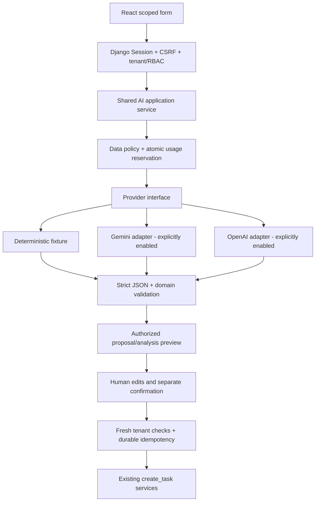

# HT-AI-P4-01 — AI Architecture, Provider Selection & Security Design

Ngày: **2026-10-28**. Trạng thái: **DESIGN COMPLETE — PENDING OWNER APPROVAL**.
Đây là thiết kế đề xuất, không phải API/schema/runtime đã triển khai.

## 1. Executive summary và thẩm quyền

Owner cho phép phân tích hai AI: Smart Task Generator và Feedback Analyzer.
Giữ Django + DRF + PostgreSQL modular monolith, React/TypeScript, SessionAuthentication,
CSRF và tenant root Profile → monthly Workspace → Task → Subtask. AI chỉ đề xuất;
mọi Task thật cần một confirmation riêng và services hiện hữu kiểm tra lại.

Đề xuất một AI application service/provider abstraction dùng chung, synchronous
cho demo, bounded input/output/timeout và không có tools/network access do model
chọn. Mặc định disabled. Fixture demo không gọi model; live synthetic demo xem xét
Gemini Free. Live customer data cần provider/data-policy/budget approval riêng.
Không tự fallback sang provider trả phí hoặc model khác.

**Đã được Owner chốt:** task này documentation only; không gọi AI/tạo key/billing;
human confirmation; giữ workflow và kiến trúc; Project và onboarding vẫn gated.
**Chưa chốt:** model/provider cụ thể, quyền dùng AI, numeric caps, lưu proposal/
usage/idempotency, TTL/retention và live smoke. Mọi thông số và API dưới đây mang
nhãn **PROPOSED — PENDING OWNER APPROVAL**, không tạo quyền mới hôm nay.

## 2. Existing architecture và source evidence

Branch `main`, HEAD `e083060`; dirty FE02/API02A/FE03/API03A/FE04 được bảo toàn.
Checkpoint FE04395 frontend/22 browser/13 launcher và backend485 là lịch sử,
không phải tests mới của lượt thiết kế. Không truy cập database hoặc đọc `.env`.

| Source đã đối chiếu | Ràng buộc thiết kế |
|---|---|
| [Task model](../backend/apps/tasks/models.py) | Priority LOW/MEDIUM/HIGH/URGENT, default MEDIUM; nullable aware deadline; MAX_HIERARCHY_DEPTH=3 nghĩa root0 +3 cạnh con, tổng4 tầng |
| [Task serializers](../backend/apps/tasks/serializers.py) | Title≤255; TaskDeadlineField chuẩn hóa UTC/chặn overflow; không có estimated_duration |
| [create_task](../backend/apps/tasks/services.py) | Nhận actor, profile_id, workspace_id, title, description, priority, deadline, parent_id; tenant lock/full_clean/audit; status PENDING do server đặt, không tự assign |
| [Workspace access](../backend/apps/workspace/access.py) | can_manage_workspace_tasks: active scopes + Profile Owner/Admin hoặc Profile Member + Workspace Admin; can_review_workspace_deliverables dùng cùng predicate |
| [Tenant mutation locks](../backend/apps/workspace/services.py) | Re-resolve membership/lifecycle và khóa theo thứ tự hiện hữu; không tin selected Profile của UI |
| [Comment service](../backend/apps/tasks/comment_services.py) | Soft-delete giữ body trong DB; API tombstone không có content. Không dùng retained deleted content làm AI input |
| [Deliverable/Review](../backend/apps/reviews/models.py), Task services | file_url là arbitrary text≤500, không phải upload/fetched media. Review có self/latest-created_at-id/state guards, không cho AI gọi decision service |
| [Notification service](../backend/apps/notifications/services.py) | Năm business events, atomic cùng mutation. Preview/analysis không tạo event hoặc Notification mới |
| [StrictInputSerializer](../backend/apps/workspace/serializers.py) | Chặn unknown fields; vẫn cần strict primitive-type validation vì DRF CharField có thể coercion |
| [Task pages](../frontend/src/pages/tasks.tsx), [Task forms](../frontend/src/features/tasks/TaskForms.tsx) | Reuse Create/Task Detail, aware local→UTC deadline forms và depth validation |
| [API client](../frontend/src/services/api/client.ts), [AuthProvider](../frontend/src/features/auth/AuthProvider.tsx) | Same-origin cookies/memory-CSRF; no automatic unsafe retry; logout/expiry cancel+clear private caches |

Chưa có AI app, endpoint, proposal store, usage ledger hoặc durable AI idempotency.
Không có Project model, duration/dependency schema. Legacy CANCELLED không phải
transition mới. Workflow vẫn PENDING→ASSIGNED→WORKING→REVIEW→COMPLETED; request
changes về WORKING; Task/Subtask độc lập, không cascade.

## 3. Use cases và các mode dữ liệu

| Mode đề xuất | Nguồn input | Egress/cost | Ranh giới |
|---|---|---|---|
| disabled, mặc định | Không nhận request AI | Không có | Không hiển thị action AI khả dụng; fail closed |
| fixture_demo | Server-curated synthetic example_id | Không gọi provider, phí AI0 | Nhãn rõ “Demo fixture — không gọi AI”; vẫn auth/tenant/confirmation khi tạo Task thật |
| live_synthetic_demo | Chỉ example_id/payload synthetic đã allowlist ở server | Một provider được duyệt; Gemini Free chỉ khi đủ quota | Không đọc brief/feedback tenant thật hoặc nhận free-form input thay fixture; checkbox client không chứng minh dữ liệu sạch |
| live_private | Brief người dùng nhập hoặc selected business feedback được authorize | Provider trả phí/data-policy được Owner duyệt | Default off; cần quyền gửi dữ liệu, retention/budget/model/account controls phù hợp |

**Generator:** Manager nhập brief trong live_private hoặc chọn synthetic example
ở demo → authorize → proposal → sửa/chọn/bỏ/sắp xếp → confirmation → Task services.
Không model-generated user assignment, reviewer, status, Profile/Workspace creation.
Dependencies chỉ là note, không quan hệ scheduling; estimated_duration chưa có
schema nên loại khỏi writable proposal v1, ghi warning/pending.

**Analyzer:** Manager/Reviewer chọn nguồn của một Task → authorize từng nguồn →
data minimization → analysis/citations → người dùng tự xử lý. Không Approve,
Request Changes, sửa Comment, tạo Task/Subtask hoặc Notification. “Create Task
from Suggestion” là scope riêng về sau, không thuộc Analyzer v1 đề xuất.

## 4. Provider comparison — snapshot có ngày kiểm tra

Nguồn chính thức được đọc **2026-10-28**; bảng không bảo đảm quyền truy cập hoặc
quota của tài khoản Owner, và phải kiểm tra lại trước implementation/live enable.
Không đo latency, chất lượng tiếng Việt hay gọi model trong task này.

| Tiêu chí | Gemini candidate | OpenAI candidate |
|---|---|---|
| Model text/JSON | gemini-3.5-flash-lite, stable | gpt-6-luna |
| Structured output | Có, subset JSON Schema | Có, strict structured output |
| Free Tier | Listed; eligibility/quota thực tế chưa xác minh | Model page không hỗ trợ Free |
| Standard paid USD/1M input/output | 0.30 /2.50; output gồm thinking | 0.10 /0.50 |
| API boundary | Gemini API; Google GenAI SDK maintained | Responses API qua OpenAI adapter |
| Tiếng Việt/latency | Cần synthetic eval; chưa đo | Cần cùng bộ eval; chưa đo |
| SDK/API stability | Pin SDK/model và check deprecations, không dùng latest alias tùy ý | Pin SDK/model và check deprecations; không giả request shape giống Gemini |

Nguồn: [Gemini model](https://ai.google.dev/gemini-api/docs/models/gemini-3.5-flash-lite),
[Gemini pricing](https://ai.google.dev/gemini-api/docs/pricing),
[OpenAI model](https://developers.openai.com/api/docs/models/gpt-6-luna),
[OpenAI pricing](https://developers.openai.com/api/docs/pricing).
Khả năng JSON không bảo đảm tính đúng/safe của domain output.
[Gemini structured output](https://ai.google.dev/gemini-api/docs/structured-output),
[OpenAI structured output](https://developers.openai.com/api/docs/guides/structured-outputs).

**Khuyến nghị, chưa APPROVED:** fixture_demo trước; Gemini3.5 Flash-Lite cho live
synthetic demo có kiểm soát. Với dữ liệu thật, đánh giá GPT-6 Luna Standard hoặc
Gemini Standard Paid sau privacy/contract approval và quality eval. Theo phép
tính mục6, OpenAI paid rẻ hơn Gemini paid trong giả định này; Gemini demo có lợi
thế quota miễn phí đủ điều kiện. Model dự phòng là adapter kia đã được cấu hình/
duyệt riêng, không phải fallback tự động lúc lỗi. Outage → trả lỗi an toàn hoặc
đề nghị người dùng chuyển fixture demo có nhãn, không giả kết quả AI thành công.

Không chọn model cũ chỉ từ trí nhớ: availability/lifecycle phải kiểm tra qua
[Gemini deprecations](https://ai.google.dev/gemini-api/docs/deprecations) và
[OpenAI deprecations](https://developers.openai.com/api/docs/deprecations).
Google hiện hạn chế dòng2.5 cho prior users;3.5 là candidate cho project mới.
Chỉ pin snapshot nếu provider thực sự cung cấp; nếu không có thì pin stable ID,
adapter/schema/prompt version và rerun regression trước đổi model.

## 5. Data handling và terms assessment

Gemini Unpaid có thể dùng input/output để cải thiện sản phẩm và human review;
không dùng dữ liệu khách hàng thật, confidential hoặc PII. Standard Paid có
chính sách khác nhưng không đồng nghĩa zero retention. Có điều kiện vùng và
data-sharing tiers cần review; loại trừ Contributor/opt-in sharing khỏi phương
án private-data. Không suy vùng hợp đồng từ timezone của repo.
[Gemini terms](https://ai.google.dev/gemini-api/terms),
[pricing tiers](https://ai.google.dev/gemini-api/docs/pricing).

OpenAI API mặc định không dùng nội dung huấn luyện trừ opt-in. Abuse monitoring
có thể giữ nội dung tới30 ngày; Responses store=false không loại mọi retention/
cache. ZDR/MAM cần approval/điều kiện riêng, không được hứa chỉ bằng một flag.
[OpenAI data controls](https://developers.openai.com/api/docs/guides/your-data).

Đây là đánh giá kỹ thuật từ tài liệu công khai, không phải xác nhận hợp đồng,
DPA, khu vực, account configuration hay tuân thủ pháp lý của HustlyTasker.
Owner cần duyệt dữ liệu được phép egress, quyền xử lý khách hàng và storage policy
trước live_private. Không bật billing/tạo account/project/key trong task này.

## 6. Cost estimation và guardrails đề xuất

Một request minh họa: **2.000 input tokens tổng** (instructions/schema/context)
và **1.000 total billable output tokens**, gồm reasoning/thinking nếu có.
Standard uncached; không Batch/Flex/Fast, tools/grounding/cache storage, retry.

`USD = requests × (2000 × input_rate + 1000 × output_rate) / 1000000`.

| Standard paid, rate từ mục4 | Mỗi request | 100 requests | 1.000 requests | 10.000 requests |
|---|---:|---:|---:|---:|
| Gemini3.5 Flash-Lite | 0.00310 | 0.31 | 3.10 | 31.00 |
| GPT-6 Luna | 0.00070 | 0.07 | 0.70 | 7.00 |

Đây là ước tính, không hóa đơn/benchmark. Chưa gồm thuế, FX/phí thanh toán,
hosting, DB, SDK overhead được token hóa hoặc phí tool nếu sau này bật. Một lần
Generator và một Analyzer là hai requests; regenerate lại tính riêng. Fixture
không gọi provider: phí AI0. Gemini Free chỉ0 trong quota đủ điều kiện, không
bảo đảm đáp ứng100/1.000/10.000 requests và không tự chuyển Paid khi hết quota.

Tất cả số dưới đây là **giá trị khởi đầu đề xuất**, cần Owner duyệt:

| Control | Proposed default |
|---|---|
| AI_ENABLED, AI_LIVE_ENABLED | false; mode disabled, chưa có các settings này trong runtime |
| Per-user requests | 3/minute,20/day; actor lấy từ session |
| Per-Workspace /Profile /global | 30/50/100 requests mỗi ngày UTC |
| Concurrency | 1/user,1/Profile,2/global; áp dụng cross-worker bằng PostgreSQL |
| Input | Brief≤6.000 code points; selected feedback tổng≤12.000, request≤32KiB; system+schema+context≤8.000 input tokens |
| Output | ≤1.500 billable tokens, gồm thinking; raw provider body≤64KiB;≤20 Task nodes hoặc10 issues/10 actions |
| Network | connect≤3s, total provider deadline≤15s; endpoint deadline≤20s; chưa đo đủ latency |
| Retry/fallback | Một generation attempt; SDK retries0; không auto JSON-repair call hoặc automatic provider/model fallback |
| Budget | Global1USD/day,5USD/month; per-Profile0.50USD/day,2USD/month; smallest applicable remaining budget wins |
| Alerts | Metadata warning tại80%; app từ chối tại100%; operator kill switch trước dispatch |
| Preview expiry | 30 phút đề xuất; expiry không phải retention hoặc tự purge |

Token count phải tính cả instructions/schema. Không dùng “số từ tiếng Việt” làm
bảo đảm token cap. Adapter cần counter chính thức/verified tokenizer; nếu chưa
đếm được an toàn thì fail closed, không dispatch theo ước lượng thấp. Nếu cần
provider count-tokens endpoint, phải duyệt riêng về data egress/chi phí và tính
vào request limits; không gọi trong lượt thiết kế. UI chỉ hiển thị estimate.

Reserve worst-case input/output cost trong transaction ngắn trước HTTP, sau đó
thả locks. PostgreSQL-backed ledger + lock theo global→Profile→Workspace→User
budget keys phải bảo vệ các request đồng thời, không chỉ sum rồi insert không
khóa. Settlement dùng usage thật (cached/reasoning tách rõ) và price_catalog_version.
Số tiền lưu Decimal/micro-USD, không float. Reservation timeout/usage thiếu giữ
worst-case ở OUTCOME_UNKNOWN đến khi reconcile; không giả hoàn phí. Transaction
Task rollback/cancel UI không hoàn lại phí generation đã gửi.

Lock families phải được review chung trước implementation: reserve/settle dùng
transaction ngắn riêng; confirmation không lấy budget locks và không gọi provider.
Đường nào cần cả hai families phải lấy budget advisory keys trước, rồi giữ thứ tự
business hiện hữu Profile→Workspace→membership→Task/source→proposal/invocation;
không có đường lấy ngược. Reserve chỉ đụng budget state; nếu foreign key hoặc
shared invocation row gây implicit business lock thì phải xét vào cùng thứ tự.
P4-02A phải chứng minh chi tiết schema/lock graph bằng concurrency/deadlock tests;
đây là yêu cầu thiết kế, chưa phải cơ chế locking đã triển khai.

DRF LocMem throttle chỉ là lớp phụ; không gọi nó production-grade budget guard.
Kill switch chặn dispatch mới, không hứa dừng request đang chạy. Env flip cần
reload đồng bộ mọi worker; trước multi-worker live phải có shared enabled/lease
gate được kiểm chứng trong ledger, không thêm Redis chỉ để làm việc này.
Unknown pricing/model/disabled feature/key thiếu → fail closed. Không lấy API key
qua request, React hoặc DB; chỉ backend secret configuration ở task sau.

Provider quotas không thay app limits: Gemini theo project/model/tier, account
quota chưa xác minh. [Gemini rate limits](https://ai.google.dev/gemini-api/docs/rate-limits).
OpenAI có organization/project/model rate limits; hard spend caps khác alerts và
enforcement có thể trễ. Chưa cấu hình cap thật; vẫn cần app reservation.
[OpenAI rate limits](https://developers.openai.com/api/docs/guides/rate-limits),
[spend limits](https://developers.openai.com/api/docs/guides/spend-limits).

## 7. Target architecture và Django boundaries



Đề xuất **một future Django app apps/ai** cho cả hai features vì durable proposals,
usage reservation và idempotency cần migrations/ownership chung. Đây vẫn là
modular monolith, không đổi stack hoặc tạo hai AI systems. App/schema cần Owner
duyệt trước code. Nếu chỉ viết pure contracts/fixture helpers ở slice đầu, có thể
giữ module stateless, nhưng không tạo song song một hệ apps/common/ai thứ hai.

| Proposed module | Responsibility |
|---|---|
| ai/views,serializers,urls | Transport/CSRF/current actor, strict request/response, scoped errors |
| ai/services | Generate/analyze orchestration, policy, provenance, reserve/settle |
| ai/selectors | Resolve Task/Review/Comment nguồn qua current tenant scope |
| ai/providers/base +fixture/gemini/openai | Một interface generate_structured(request,deadline) → normalized result/usage/error |
| ai/schemas,validation | Contract version, common JSON subset, strict types, DAG/citations/domain validation |
| ai/confirmation | Whole-plan validation, existing lock order, atomic calls to tasks.services.create_task |
| ai/models +usage | Proposed proposal/idempotency/usage state, cross-worker quotas and shared dispatch gate |

Provider DTO không chứa request User object, DB connection hoặc mutation callback.
Request gồm feature/schema/prompt versions, minimized text, output schema, cap và
deadline; adapter model config chỉ từ server allowlist. Result gồm normalized
text/JSON, usage và sanitized status, không raw HTTP headers/key hoặc chain-of-thought.
Gemini/OpenAI parameters được map riêng; OpenAI Responses store=false; tools,
search, URL context, file uploads, function execution và persistent conversations
không dùng trong v1. Chưa cài SDK; pin maintained SDK ở implementation sau.
[Google libraries](https://ai.google.dev/gemini-api/docs/libraries).

Synchronous phù hợp demo ít traffic với caps trên; chưa đo p95. Không giữ DB
transaction/row locks trong lúc đợi provider. Nếu sau benchmark vẫn vượt deadline,
đề xuất background-job design riêng, không âm thầm thêm Celery/Redis/WebSocket.

## 8. Proposed persistence và human confirmation

**NOT IMPLEMENTED; additive schema proposal cần approval.** Hai logical stores:

- AiProposal: actor + Profile/Workspace/(Task nếu analysis), purpose, contract/
  prompt/model versions, normalized bounded JSON, revision/content hash, source
  fingerprint, generated/expires/confirmed state và created Task map. Không raw
  confidential brief hoặc raw provider response. Proposal content vẫn có thể
  confidential: Owner phải duyệt access/encryption/retention trước live_private.
- AiInvocation: request/idempotency key hash, request fingerprint, purpose/scope,
  state, reservation/actual billable usage/cost, policy/price versions, safe error
  code, provider request correlation nếu an toàn. Không prompt/feedback/key/cookie.

Fingerprint của brief/feedback confidential dùng server-keyed HMAC có version,
không plain hash dễ dò input ít entropy; không log hoặc trả fingerprint đó ra
public API. Key management/rotation là phần thiết kế persistence cần review,
không thêm secret hoặc dùng lại credential khác trong task này.

Không dùng AuditLog như proposal/cache store, LocMemCache hoặc browser signature
để giả bảo đảm durable replay protection. Budget keys/dispatch gates trong
PostgreSQL phải dùng unique rows/advisory locks hoặc equivalent transaction-safe
design đã review. Chưa quyết định bảng counters riêng; detailed migration plan
là deliverable P4-02A trước tạo migration. No arbitrary tenant backfill.

Generate/analyze: authorize → short reserve transaction → HTTP outside locks →
validate → reauthorize + source fingerprint check → short settle/store transaction
→ response. Provider lỗi vẫn ghi safe usage outcome; quyền bị revoke khi call
đang chạy thì không trả/store content usable cho người đó. Egress đã xảy ra
không thể thu hồi, dù late UI response bị loại bỏ.

Confirmation protocol đề xuất:

1. Session+CSRF; resolve Profile/Workspace và manager capability hiện tại.
2. Outer atomic: lock theo helper hiện hữu Profile→Workspace→membership rồi
   proposal/confirmation ledger. Không đảo lock order hoặc có HTTP trong block.
   Sau proposal chỉ tạo nodes mới và lock parents vừa tạo trong cùng transaction;
   không lấy lock foreign/existing Task parent. Shared/existing source locks, nếu
   cần, phải lấy trước proposal theo thứ tự ở mục6.
3. Check proposal actor/tenant/purpose/revision/expiry, immutable mode/provenance,
   same idempotency key+canonical edited-body fingerprint; validate toàn DAG.
   Trước expiry check cho lần tạo mới, kiểm tra committed confirmation record:
   same key/body đã commit chỉ phục hồi result sau fresh authorization, kể cả
   preview đã hết hạn nếu ledger còn lưu; không chạy lại create_task.
4. Tạo topological order qua unchanged create_task từng node; local parent refs
   chỉ map tới IDs vừa tạo trong cùng plan. created_by/current actor và PENDING
   do service đặt. Không assign, set status hoặc link parent ngoài plan v1.
5. Task rows, existing safe audits, confirmed proposal và result mapping commit
   cùng transaction. Node/audit failure bất kỳ rollback toàn batch.
6. Same key/body retry sau response loss trả cùng IDs sau fresh access check;
   key/body khác hoặc revision stale→409. Unique idempotency(scope,actor,operation,
   key_hash) **và một lần confirm/proposal** ngăn dùng key khác để tạo lần2.

Generate/analyze cũng dedup cùng request key/fingerprint; in-flight duplicate
trả409 IN_PROGRESS, không dispatch lần2. Completed same-key/same-body trả artifact
cũ với200, không gọi provider; khác body trả409 IDEMPOTENCY_CONFLICT. Mất response
thì gửi lại cùng POST/key/body để tìm artifact dù chưa biết proposal_id.
Outcome unknown không auto-generate lần nữa. Chỉ bảo đảm
dedup trong cùng request/proposal, không hứa phát hiện mọi semantic duplicate
giữa các brief khác nhau. Expired preview cần review/generate mới; không tự xóa
Task hoặc purge proposal. TTL30 phút không quyết định thời hạn retention vật lý,
backup/audit hay purge job; các quyết định này vẫn pending Owner.
Generate/analyze replay khi unconfirmed preview đã expired trả409 EXPIRED và
không redispatch. Retention của committed confirmation ledger phải bao phủ cửa sổ
recovery được Owner duyệt; không hứa replay vô hạn sau khi ledger bị xóa hợp lệ.

## 9. Proposed API contracts — NOT IMPLEMENTED

Không endpoint nào dưới đây hiện tồn tại trong routes. Giữ API v1 nesting;
không AllowAny, client-supplied actor/provider/model/key/mode hoặc CSRF bypass.
Đề xuất tất cả AI actions trước mắt dùng current active manager/reviewer gate:
can_manage_workspace_tasks /can_review_workspace_deliverables + scoped read.
Đây là **quyền feature mới đề xuất**, không tự suy từ quyền đọc của Editor/Viewer,
is_staff hoặc existing can_submit/can_approve. Owner duyệt trước implementation.

Base: `/api/v1/profiles/{profile_id}/workspaces/{workspace_id}/`.

| Method + suffix | Body / response đề xuất |
|---|---|
| POST ai/task-proposals/ | Private mode: brief +reference_time/timezone tùy chọn; demo: example_id. Strict one-of, server mode determines shape. 201 normalized proposal envelope; không tạo Task |
| POST ai/task-proposals/{proposal_id}/confirm/ | proposal_revision +confirmed=true +edited proposal v1;201 created map. Same valid replay200, fresh authorization required |
| POST tasks/{task_id}/ai/feedback-analysis/ | selected review_ids/comment_ids/deliverable_ids bounded, optional focus. Demo mode chỉ example_id;200 analysis envelope, không business mutation |
| GET ai/proposals/{proposal_id}/ | Read stored nonexpired own proposal after fresh tenant/feature authorization; analysis còn phải kiểm tra lại từng nguồn/fingerprint. Không gọi model |

UI availability hint đề xuất tái sử dụng DRF OPTIONS convention hiện có trên
Workspace/Task routes: additive read-only can_generate_task_proposal và
can_analyze_feedback, tính từ request actor/current tenant/feature policy, false
khi disabled. Contract chi tiết cần test ở slice sau; không tạo client-side role
inference hoặc endpoint trùng. Hint không giữ quyền cho request tương lai, không
lộ key/account/budget tenant khác; POST/confirmation luôn kiểm tra lại.

Idempotency-Key UUID bắt buộc cho unsafe AI operations, không token authentication;
server hashes key và binds request scope/actor/body. Unknown fields rejected.
Private generator brief≤6000; optional reference_time RFC3339 with offset,
timezone IANA verified; không đủ thời điểm tuyệt đối thì deadline null/warning.
Không mặc định “cuối tuần”=thứ Sáu/Chủ nhật hoặc ép deadline vào Workspace month.

Mọi GET/replay analysis đều resolve lại selected sources, quyền đọc, tombstone và
source fingerprint trước khi trả saved content. Nguồn thay đổi/xóa→409
SOURCE_CHANGED, không trả payload cũ; scope mất quyền→404 theo tenant convention.
Frontend bỏ preview khi nhận lỗi và revalidate khi focus/use; không hứa xóa ngay
content đã hiển thị ở browser khác khi chưa có realtime revocation mechanism.

Common response envelope với payload synthetic hợp lệ; không phải AI đã chạy:

```json
{
  "contract_version": "ai.v1",
  "request_id": "00000000-0000-4000-8000-000000000001",
  "proposal_id": "00000000-0000-4000-8000-000000000002",
  "revision": 1,
  "mode": "fixture_demo",
  "provider": "fixture",
  "model": "synthetic-plan-v1",
  "expires_at": "2026-10-28T10:30:00Z",
  "payload": {
    "contract_version": "ai.task-plan.v1",
    "tasks": [{"local_ref":"item_1","parent_ref":null,"title":"Kiểm tra phụ đề","description":"Ví dụ synthetic để minh họa contract.","priority":"MEDIUM","proposed_deadline":null,"notes":""}],
    "assumptions": [],
    "warnings": []
  },
  "usage": {"input_tokens": 0, "billable_output_tokens": 0, "estimated_cost_usd": "0.000000", "status": "known"}
}
```

`payload` là một trong hai schemas ở mục10. UUID provenance tạo ở server, không
đưa cho model tự sinh. created mapping chỉ từ service sau confirm. Tất cả private
responses Cache-Control:no-store; frontend memory-only scoped state, không HTTP
shared cache. Không client chọn/free-tier flag để vượt data gate hoặc budget.
Safe error: `{error:{code,message,request_id,fields}}`, field messages allowlist;
không raw provider error, prompt snippet, key, DSN, tokens hoặc tên nguồn ngoài scope.

| HTTP | Proposed stable codes / recovery |
|---|---|
| 400 | INVALID_INPUT / INVALID_PLAN, named field errors; không gọi provider khi request invalid |
| 403 | FORBIDDEN / CSRF, current actor không có feature authority |
| 404 | NOT_FOUND cho missing/cross-tenant object, không phân biệt ID tồn tại ở tenant khác |
| 409 | IDEMPOTENCY_CONFLICT / IN_PROGRESS / STALE_PROPOSAL / SOURCE_CHANGED / EXPIRED; không tự retry mutation |
| 422 | AI_OUTPUT_REJECTED / AI_REFUSED, generic public error; không hiển thị invalid output như proposal usable |
| 429 | RATE_LIMITED / BUDGET_EXCEEDED, Retry-After nếu có nghĩa; không automatic retry |
| 502/503/504 | PROVIDER_UNAVAILABLE / AI_DISABLED / TIMEOUT; usage có thể unknown, không gọi provider dự phòng |

Compatibility gap đã xác minh: shared ApiError hiện chưa giữ nested error.code/
fields và422 mặc định thành server error. Slice UI sau phải mở rộng parser hiện
hữu theo cách tương thích ngược: allowlist AI codes/messages, normalize fields/
Retry-After, giữ nguyên Django/DRF session/CSRF errors. Không tạo API client hoặc
AuthProvider thứ hai. Test422 refusal,429 budget,409 stale/lost response và no
retry loop; contract trên chưa hoạt động với client hiện tại nếu chưa có extension.

Cancelled client request không chứng minh provider chưa nhận/không tính phí.
Confirmation chưa được UI gọi thì không có Task; client abort khi confirm đang
commit có thể mất response, phải retry cùng key/body để nhận cùng created map.

## 10. Structured JSON schemas v1 — đề xuất, examples synthetic

Canonical JSON Schema dùng để đặc tả contract, không phải file runtime hoặc
migration. Adapter chiếu sang subset provider hỗ trợ; backend vẫn validate toàn
bộ canonical schema/semantics. Không cần thêm Pydantic trong stack hiện tại:
DRF strict fields/validators có thể thực hiện cùng contract. Nếu sau này chọn
Pydantic để giảm duplication thì cần dependency review riêng, không là điều kiện
ngầm của thiết kế này. Frontend type guards không thay server validation.

Task plan dùng flat node array với local parent_ref; UI render như Task/Subtask
hữu hạn. Tránh recursive JSON không giới hạn và database IDs do model bịa.

```json
{
  "$schema": "https://json-schema.org/draft/2020-12/schema",
  "$id": "urn:hustlytasker:ai:task-plan:v1",
  "type": "object",
  "additionalProperties": false,
  "required": ["contract_version", "tasks", "assumptions", "warnings"],
  "properties": {
    "contract_version": {"const": "ai.task-plan.v1"},
    "tasks": {
      "type": "array", "minItems": 1, "maxItems": 20,
      "items": {
        "type": "object", "additionalProperties": false,
        "required": ["local_ref", "parent_ref", "title", "description", "priority", "proposed_deadline", "notes"],
        "properties": {
          "local_ref": {"type": "string", "pattern": "^item_[1-9][0-9]{0,2}$"},
          "parent_ref": {"type": ["string", "null"], "pattern": "^item_[1-9][0-9]{0,2}$"},
          "title": {"type": "string", "minLength": 1, "maxLength": 255},
          "description": {"type": "string", "maxLength": 2000},
          "priority": {"enum": ["LOW", "MEDIUM", "HIGH", "URGENT"]},
          "proposed_deadline": {"type": ["string", "null"], "format": "date-time"},
          "notes": {"type": "string", "maxLength": 500}
        }
      }
    },
    "assumptions": {"type": "array", "maxItems": 10, "items": {"type": "string", "maxLength": 300}},
    "warnings": {"type": "array", "maxItems": 10, "items": {"type": "string", "maxLength": 300}}
  }
}
```

Giới hạn description2000 là proposed AI envelope cap, không sửa giới hạn của
Task metadata API thông thường. Semantic validation bắt buộc: unique local_ref,
parent thuộc cùng plan, không self/cycle, root depth0 và maxdepth3; topological
creation độc lập thứ tự array, không coi array index là DB identity. Sibling
reorder là preview presentation; Task chưa có ordering field nên không hứa lưu
thứ tự tùy ý sau commit. Không nhận estimated_duration/dependency edges/status/
owner/assignee/reviewer/tenant/audit fields. Deadline thiếu offset/overflow hoặc
“cuối tuần” không được đổi thành thời điểm suy đoán. UTC normalization giữ instant;
không có constraint deadline phải nằm trong tháng Workspace hoặc trước parent.
Confirmation chỉ map title/description/priority/proposed_deadline→deadline và
parent_ref→new parent_id. Notes/assumptions/warnings không có cột Task riêng;
chỉ lưu vào description nếu người dùng chủ động sửa description trước confirm.

Synthetic payload minh họa, **không phải kết quả model đã chạy**:

```json
{
  "contract_version": "ai.task-plan.v1",
  "tasks": [
    {"local_ref":"item_1","parent_ref":null,"title":"Sản xuất 10 video quảng cáo","description":"Lập kế hoạch nội dung và bàn giao 10 video ngắn.","priority":"HIGH","proposed_deadline":null,"notes":"Cần xác nhận deadline tuyệt đối."},
    {"local_ref":"item_2","parent_ref":"item_1","title":"Chỉnh màu và thêm phụ đề","description":"Áp dụng nội dung được người quản lý duyệt.","priority":"MEDIUM","proposed_deadline":null,"notes":"Phụ thuộc footage sẵn sàng; đây là ghi chú, không dependency record."}
  ],
  "assumptions": ["Brief là ví dụ synthetic, không chứa dữ liệu khách hàng thật."],
  "warnings": ["Chưa đủ ngày/giờ/timezone cho 'cuối tuần'.", "Estimated duration chưa có schema được duyệt."]
}
```

Feedback analysis canonical schema:

```json
{
  "$schema": "https://json-schema.org/draft/2020-12/schema",
  "$id": "urn:hustlytasker:ai:feedback:v1",
  "type": "object", "additionalProperties": false,
  "required": ["contract_version", "summary", "issues", "suggested_actions", "uncertainty", "warnings"],
  "properties": {
    "contract_version": {"const": "ai.feedback.v1"},
    "summary": {"type": "string", "minLength": 1, "maxLength": 1600},
    "issues": {
      "type": "array", "maxItems": 10,
      "items": {
        "type": "object", "additionalProperties": false,
        "required": ["category", "description", "source_refs"],
        "properties": {
          "category": {"enum": ["CLARITY", "TECHNICAL", "CONTENT", "PROCESS", "OTHER"]},
          "description": {"type": "string", "minLength": 1, "maxLength": 500},
          "source_refs": {"type": "array", "minItems": 1, "maxItems": 5, "uniqueItems": true, "items": {"type": "string", "pattern": "^S[1-9][0-9]?$"}}
        }
      }
    },
    "suggested_actions": {
      "type": "array", "maxItems": 10,
      "items": {
        "type": "object", "additionalProperties": false,
        "required": ["action", "priority", "rationale", "source_refs"],
        "properties": {
          "action": {"type": "string", "minLength": 1, "maxLength": 500},
          "priority": {"enum": ["LOW", "MEDIUM", "HIGH", "URGENT"]},
          "rationale": {"type": "string", "maxLength": 300},
          "source_refs": {"type": "array", "minItems": 1, "maxItems": 5, "uniqueItems": true, "items": {"type": "string", "pattern": "^S[1-9][0-9]?$"}}
        }
      }
    },
    "uncertainty": {"type": "string", "maxLength": 600},
    "warnings": {"type": "array", "maxItems": 10, "items": {"type": "string", "maxLength": 300}}
  }
}
```

Ví dụ với server-resolved nguồn synthetic S1: “Phụ đề khó đọc trên nền sáng”:

```json
{
  "contract_version": "ai.feedback.v1",
  "summary": "Cần kiểm tra độ tương phản phụ đề.",
  "issues": [{"category":"TECHNICAL","description":"Nguồn S1 phản ánh phụ đề khó đọc.","source_refs":["S1"]}],
  "suggested_actions": [{"action":"Kiểm tra tương phản trên các cảnh nền sáng.","priority":"MEDIUM","rationale":"Hỗ trợ khả năng đọc theo phản hồi đã chọn.","source_refs":["S1"]}],
  "uncertainty": "Không xem file video; chỉ phân tích feedback text được cung cấp.",
  "warnings": []
}
```

S1 phải thuộc source map do backend tạo; regex hợp lệ không đủ. Không cho model
trả raw Task/User/Review IDs hoặc URL để UI tự fetch. Envelope bổ sung source map
được server resolve và coverage: selected_count/included_count/omitted_count,
reasons và opaque source revision; fingerprint HMAC chỉ ở server, không trả API.
Không PII author không cần thiết. Limit20 source
items tổng, source text tổng12000; nếu quá cap trả validation/coverage warning để
người dùng chọn lại, không âm thầm coi current Comment page là toàn bộ feedback.

## 11. Validation pipeline và contract versioning

1. Strict HTTP body size/content-type/known fields và primitive types; chặn NUL,
   invalid Unicode, unpaired surrogate, scalar coercion, oversized collections.
2. Authorize scope/data mode trước query dữ liệu hoặc bất kỳ provider egress.
   Server resolve selected IDs qua Task→Workspace→Profile; nguồn khác parent404.
3. Tạo prompt data-only với S1/S2 labels và instructions cố định versioned. Không
   interpolate brief thành system instructions hoặc tool/SQL/HTTP command.
4. Nhận bounded response; phân biệt provider refusal/safety block/empty/incomplete/
   token-limit finish reason với JSON thành công. Không trả phần truncated như valid.
5. Parse đúng một JSON object: reject duplicate keys, NaN/Infinity, trailing text,
   code-fence-only output, extra fields; không repair bằng call mới tự động.
6. Canonical schema rồi domain validators: unique refs/DAG/depth/enums/aware date,
   citation whitelist và max total lengths. Không tin default coercion của DRF.
7. Reauthorize sau provider, kiểm tra fingerprint nguồn còn hiện hành; stale or
   revoked thì không publish late output. Payload/hash/provenance do server quản lý.
8. Edited confirmation được validate lại độc lập rồi gọi Task services; schema-valid
   output vẫn có thể sai nội dung. Người dùng chịu trách nhiệm review nghiệp vụ.

`ai.v1` envelope và `ai.task-plan.v1`/`ai.feedback.v1` payload được test fixtures
versioned. Unknown version409/400 theo field, không deserialize best-effort.
Prompt_version/schema_version/model/price_catalog_version được lưu metadata.
Provider format đổi chỉ trong adapter, không đổi frontend business contract.
Breaking shape cần version mới và compatibility review; không lặng lẽ thêm enum/
field từ model vào Task. Duplicate suggestions flag warning; không xóa nội dung
cùng title tự động vì có thể là công việc khác hợp lệ.

## 12. Frontend UX integration — design only

Reuse [master](design-system/hustlytasker/MASTER.md), React forms/Alert/Card/native
Dialog và shared API client; chưa tạo React page/component hoặc nút AI thật.

| Điểm tương tác đề xuất | Hành vi |
|---|---|
| TasksPage header cạnh Create | “Tạo đề xuất bằng AI”, chỉ khi server feature/role/config hint hợp lệ; same tenant check tại POST |
| Brief step | Label rõ mode/provider/data disclosure và cost estimate cap trước Generate. Free demo chỉ chọn example server, không editable real brief gửi đi |
| Preview/Edit step | Bounded nested cards, title/description/priority/deadline chỉnh được, select/remove, sibling Move up/down buttons; không assignee/status controls |
| Confirm step | “Tạo N công việc” với Workspace/month/timezone/count summary, explicit all-or-nothing; Generate/Regenerate không tạo Task; không optimistic success |
| TaskCollaboration Review/Deliverable card | “Phân tích feedback” với selected source/coverage summary; summary/issues/actions/citations/uncertainty hiển thị inline Task Detail |
| Analyzer use | Copy plain text hoặc dùng thủ công; không nối action vào Approve/Request Changes hoặc tạo Subtask |

Brief→Preview→Confirm có step indicator và focus transition. Preview inline
trong scope hiện có, không làm modal thành primary navigation. Generated text
escaped/plain text; không render HTML/Markdown link chưa sanitize. Citation links
do server/local route mapping, target access rechecked; không follow model URL.

375px single-column;768/1440 tận dụng cùng card grid; landscape và long text không
horizontal overflow. Keyboard đầy đủ: visible focus, no drag-only, labels/hints,
linked focusable error summary+inline messages. Loading aria-live=polite, không
fake %. Complete focus preview heading; idle Dialog Escape/focus return; khi
pending chặn double submit. Cancel không hứa refund provider cost; late response
không tự create. Confirm response lost dùng cùng idempotency key để recover.

403/404 ẩn private output, finite error recovery;409 stale/expired yêu cầu review
lại;429 hiển thị reset/budget message, không refetch/retry loop. Logout/session
expiry/Profile/Workspace change abort+clear preview. Query keys gồm current User/
Profile/Workspace/Task/feature/request; không localStorage/autosave confidential
brief hoặc cross-user cache. Success confirm invalidates existing Task scope;
không tạo Notification event mới chỉ vì dùng AI.

UI UX Pro Max đã đọc đầy đủ; local CLI dùng Python hiện hữu với -B, không đọc
environment private và không ghi runtime. Searches thực chạy exit0:
`multi step review confirmation --domain ux` (step/progress/confirmation),
`async form cancellation --stack react` (caught async errors),
`dragging movements --domain ux` (button/keyboard alternative). Chỉ áp dụng phần
web phù hợp; không theme mới, mobile-native requirements hoặc React-wide refactor.
Đây là thiết kế/test plan, không tuyên bố browser/axe đã chạy cho AI UI chưa có.

## 13. RBAC, tenant isolation và threat matrix

Default proposed role gate trong active scopes: Profile Owner/Admin **hoặc**
Profile Member có Workspace Admin membership đang hoạt động; cả Generator lẫn
Analyzer dùng existing manager/reviewer predicate. Editor, Viewer, Client và
staff không có tenant authority không được gọi chỉ vì đọc được
Task. Nếu Owner muốn Editor dùng Analyzer, phải chốt capability/usage policy riêng;
không sửa existing Review permission để đạt mục tiêu đó.

| Threat | Entry point / impact | Mitigation đề xuất | Required tests |
|---|---|---|---|
| Cross-Profile/Workspace IDOR | IDs/queryset hoặc proposal_id → rò dữ liệu/chi phí tenant khác | Resolver hiện hữu; filter toàn chain và actor-owned proposal; generic404 | Multi-Profile/foreign nested IDs/proposal replay |
| Read access bị coi là AI authority | Viewer/Editor/staff → unauthorized egress/billing | Explicit feature gate active manager; server config, no client override | Roles, inactive/revoked, archived contexts |
| Prompt injection | Brief/Comment bảo model bỏ policy/đọc secrets | Untrusted labeled data, fixed system instructions; model không có tools/secrets; output validation | Multilingual injection, encoded instructions, malicious source |
| Confidential data tới unpaid | Arbitrary brief hoặc tenant feedback | Server-curated synthetic only; no checkbox trust; private mode separately approved | forged mode/model/data_class; unchanged provider call count0 |
| Excessive context/PII | Gửi Workspace/User/Audit nguyên khối | Bounded selected text; exclude User PII/tokens/cookies/Audit; review redaction limits | Prompt inspection asserts no forbidden fields/sources |
| Tombstone leakage | DB Comment.content vẫn còn sau delete | Chỉ nondeleted current-readable source; recheck fingerprint | deleted/edited while call in flight |
| SSRF/data exfiltration | file_url/model URL → fetch nội bộ hoặc tải file | Không URL fetch/tools/search/function calls; egress fixed provider hosts server-side | localhost/cloud-metadata URL, arbitrary base_url/model IDs |
| Unsafe output mutation | Model tạo status/assignee/tenant/SQL | additionalProperties=false, strict types/DAG, existing services only after confirm | extra fields/foreign refs/status injection/NaN/duplicate JSON keys |
| Hallucinated citations | Bịa S99 hoặc source không chọn → misleading context | Server source map whitelist/coverage, no direct database-ID model access | valid regex nhưng unknown/ref from another Task |
| XSS/phishing | Output HTML/link trong preview | Plain text escape, safe local citation routes, no dangerous HTML | script/javascript/HTML and oversized output |
| Double/replayed confirm | Concurrent clicks/keys/response loss → duplicate Tasks | Durable unique scope/key/body + single-confirmed proposal; atomic whole batch | concurrent same/different keys, old revision, lost response |
| TOCTOU authority/state | Revoke/archive sau GET/generate | Fresh pre/post-provider and locked confirmation checks | revoke mid-call/confirm, lifecycle races |
| Budget race/abuse | Many workers, large input, infinite retry | Atomic reservation+leases; caps; SDK retry0; no paid fallback | parallel users/providers, timeout, kill switch |
| Logging leak | HTTP errors/APM/analytics/audit → prompt/key/response | Static errors, no raw request/response logging, safe metadata only | captured logs/exception tracing/browser analytics have no secret/content |
| Provider outage/config compromise | Changed base URL/key/model/tier | Server allowlist, pinned config, fail closed, approved operator change | missingkey/unknownmodel/invalid TLS/429/5xx |

Các mitigations giảm rủi ro; không tuyên bố prompt injection được “giải quyết” chỉ
bằng prompt text, regex hoặc JSON mode. Egress policy và absence of model tools
là ranh giới chính. Redaction tự động không chứng minh brief chứa dữ liệu thật
đã thành synthetic; không mở unpaid mode cho business text nhờ regex sanitization.

## 14. Failure modes và user recovery

| Failure | Kết quả/hành động |
|---|---|
| Feature disabled/key/model/policy thiếu |503 trước dispatch, không egress; nút unavailable, không startup auto-enable |
| Không có feedback readable/selected |400 và source-selection guidance; không gọi model với empty context |
| Input/token/budget vượt cap |400 hoặc429 trước call; đổi input/chờ/Owner budget review |
| Provider429/5xx/refusal | Sanitized error; không lộ provider response, không fallback/repair loop |
| Timeout/disconnect/usage thiếu | OUTCOME_UNKNOWN, giữ reservation; thông báo có thể đã tính phí, retry cần hành động mới có kiểm soát |
| Invalid/truncated JSON | Reject output, không tạo usable proposal hoặc Task; actual usage vẫn settle nếu known |
| Source/permission đổi khi gọi |409/404 an toàn, không hiện late private analysis; phí đã dùng không tự refund |
| Confirm validation/audit failure | Rollback toàn batch+confirmation; không partial Task, giữ proposal cho safe retry nếu còn hợp lệ |
| Confirm committed nhưng response mất | Same key/body + fresh access trả cùng Task map, không tạo lại |
| App crash sau reservation/dispatch | Không tự retry trên startup. Reservation/dispatch state cần reconciliation; test leases/unknown outcome trước live |
| Model deprecated/quota unavailable | Disable candidate, cập nhật configuration/evals theo approval; fixture fallback chỉ khi người dùng chọn và có nhãn |

## 15. Audit, usage và observability

Giữ existing Task audits; wrapper có thể ghi proposed AI metadata events với actor,
scope/request/proposal IDs, feature, mode/provider/model/prompt/schema/price versions,
latency, input/output/thinking/cached usage, reserve/actualcost, safe outcome code.
Không brief/Comment/Review body, provider key, session cookie, token hoặc raw model
response. Không sao chép business feedback vào AuditLog. AI events không là
Notification business event; policy hiện tại không đổi.

Operational counters/error metrics chỉ metadata; không bật SDK debug/tracing/APM
capture body mặc định. Usage actual có thể incomplete; không ghi0 thay unknown.
Alerts tại80% cần operator xem, không tự nâng budget. Audit/usage/proposal retention,
hard delete/purge và quyền operator chưa duyệt; không tự đặt retention bắt buộc,
cron hoặc background job. Không claim encryption-at-rest đã có khi chưa verify.

## 16. Test strategy cho implementation sau

Không rerun full395/485/22 suite cho thay đổi docs-only này. Các test sau là
**plan cần thực thi khi có code**, không phải PASS hôm nay:

| Layer | Coverage bắt buộc |
|---|---|
| Adapter/unit | Fixture deterministic, normalized DTO, JSON format mapping, refusal/incomplete/blank, timeouts, SDK retry0, usage unknown, unsupported model/version |
| Validation/unit | Wrong primitives/coercion, duplicate keys/NaN, extra fields/status/IDs, priority/deadline/overflow/Unicode, DAG/depth/count, citations, unknown version, total token caps |
| Security/backend | Session+CSRF, Viewer/Editor/staff denied, Profile/Workspace IDOR, archived/revoked/inactive, scope changed mid-call, prompt injection, tombstones/PII not egressed/logged |
| PostgreSQL concurrency | Simultaneous reservations across workers, lock-family/FK deadlocks, single-confirmed proposal across keys, same-key/different-body conflict, all-or-nothing Task+audit, response loss/replay, crash/unknown reconciliation |
| Frontend | Visibility from server hint, brief/preview/edit/remove/order, explicit confirm/cancel, field errors/loading/refusal/429/409, context abort/expiry/logout/cache isolation, no optimistic Task mutation |
| Real isolated integration | Mock/fixture provider + real Django/PostgreSQL/React; full generate-preview-edit-confirm and analyze-citations-no-mutation; Review/Comment/Notification regressions |
| UX/a11y |375/768/1440+landscape, keyboard/focus/Escape/error links, no drag-only/overflow, axe, safe screenshots without secrets |
| Cost/privacy | No key/live network in CI, budget race/kill switch/unknown usage, no auto paid fallback, sanitized logs, synthetic-only unpaid enforcement |

Vietnamese eval corpus đề xuất20 synthetic briefs +20 feedback bundles, including
ambiguous dates/injection/contradictions. Measure structural-valid rate, coverage,
citation correctness/hallucination, deadline assumptions, usefulness, p50/p95
latency and actual billable cost with same limits. Passing target/thresholds need
Owner review; không tự tuyên bố model nào tốt hơn tiếng Việt khi chưa benchmark.
Live smoke cần approval riêng với provider/model/data/budget/request count cụ thể;
CI không có secret/live key hoặc khả năng tự gọi model khi feature toggle sai.

## 17. Implementation roadmap đề xuất

| Task/slice | Scope | Gate trước bước kế |
|---|---|---|
| HT-AI-P4-01 | Architecture/provider/API/security/UX design hiện tại | DESIGN COMPLETE rồi Owner review; không runtime |
| P4-02A, proposed | Strict contracts, shared app/module boundary, deterministic adapter, detailed durable proposal/usage/idempotency schema + isolated tests | Owner duyệt app/additive schema, TTL/retention và atomic batch trước migration; không live key |
| P4-02B, proposed | Smart Generator service/disabled live adapter, budgets/usage and confirmation backend qua existing Task service | Mocked adapter tests, PostgreSQL concurrency/security; persistent rollout approval riêng, live smoke riêng |
| P4-02C, proposed | React brief/preview/edit/confirm UI và real isolated fixture E2E | Current regression/CSRF/tenant/a11y PASS; UI không bypass backend |
| HT-AI-P4-03, proposed | Feedback source resolver, minimized context, structured analysis/citations panel dùng chung abstraction | No decision/Task mutation, source/revoke tests; separate Owner approval |
| HT-AI-P4-04, proposed | AI acceptance/cost/security/provider failure hardening, Vietnamese eval | Review evidence/cost envelope trước live enable/deployment |

P4-02B/C là slices của Smart Task Generator, không tự tạo task mới đang hoạt động.
Schema rollout tương lai phải inventory/backup/rehearsal và approval persistent
development riêng, không suy “database trống” từ checkpoint trước. Không thêm
estimated_duration, Project hoặc background infrastructure trong các slices này
nếu chưa có approval tương ứng. Fixture generate-only có thể test trước schema,
nhưng confirmation/live không được giả durable guarantee khi ledger chưa có.

## 18. Pending Owner decisions — không ghi APPROVED

| ID | Đề xuất cần review | Vì sao cần chốt |
|---|---|---|
| AI-D01 | Fixture first; Gemini3.5 Free chỉ curated synthetic; GPT6Luna hoặc Gemini Standard Paid cho private mode sau review | Provider/model/account/data egress decision, không tự bật billing |
| AI-D02 | Manager/reviewer-only cho cả hai AI ở v1 | Không tự cấp AI-cost authority từ read access; Editor access cần quyết định riêng |
| AI-D03 | Một future apps/ai với proposal +invocation/usage/idempotency persistence | Current schema không có durable store; detailed additive migration/counters cần review |
| AI-D04 | Preview expiry30 phút; physical retention/encryption/access/purge policy riêng | Expiry không xóa dữ liệu; proposal-derived content có thể confidential |
| AI-D05 | Numeric caps/budgets/concurrency/timeouts ở mục6 | Cân bằng demo/chi phí; phải đo/kiểm chứng trước live |
| AI-D06 | Strict plan schema, local DAG, ≤20 nodes, atomic confirmation; no assignment/status/duration persistence | Scope/API compatibility và no partial batch; requests bigger phải reject hoặc user giảm plan |
| AI-D07 | Ambiguous dates→null/warning; reference_time/timezone explicit, no parent/month deadline constraint | Giữ existing business rules, không đoán weekday/hour |
| AI-D08 | Analyzer selected one-Task text scope, categories/citations và no create-from-suggestion v1 | Quyền/cost/data minimization/feedback coverage |
| AI-D09 | Operator model/price/kill-switch governance và shared ledger mechanism trước multi-worker live | Tránh local-cache guarantees và config changes không kiểm soát |
| AI-D10 | Paid provider DPA/region/retention/data-sharing configuration, live smoke budget và Vietnamese eval thresholds | Không thể xác minh bằng tài liệu công khai/tác vụ docs-only |

Những Owner decisions cũ về Profile/multi-owner/Workspace tháng/internal Review/
soft-delete/migration safety vẫn hiệu lực; không hỏi lại hoặc âm thầm sửa chúng.
Project — PENDING OWNER DECISION. Invitation/Profile Creation/Membership
onboarding giữ task riêng; AI không giải quyết tenant bootstrap bằng cách tạo
Profile/Workspace tự động.

## 19. Acceptance gates cho task AI kế tiếp

- Có approval cụ thể cho scope/code/app/schema và data policy; thiết kế hoàn tất
  không tự cho phép P4-02 hoặc API call có phí.
- Disabled/fixture/live gates fail closed; deterministic CI không đọc live key,
  không provider calls/charges hoặc customer data; mock response ghi đúng nhãn.
- Adapter+strict schemas/provenance/usage errors tested; no output-coercion/extra
  fields, no estimated_duration/business-role field được thêm ngầm.
- Tenant/role/CSRF/current-source gates trước và sau HTTP; no confidential logging,
  no tombstones/PII/URL fetching, no unlimited context/token usage.
- Durable unique key+body/single-confirmed proposal, cross-worker budget reservation,
  atomic Task creation/audit rollback được test bằng PostgreSQL isolation/concurrency.
- Real UI preview/edit/confirmation và separate Analyzer read-only behavior,
  session/cache/errors/a11y/responsive checked; existing full regressions PASS.
- Approval riêng cho persistent migration rollout và bounded live smoke; không
  ghép chúng vào startup, tests hoặc fallback.
- Handover ghi actual test/exit/cleanup/cost-limit evidence; không dùng baseline
  lịch sử để tuyên bố AI implementation hoặc live provider đã hoàn thành.

## 20. Requirement traceability và verification hiện tại

| Authority/requirement | Mapping |
|---|---|
| Owner HT-AI-P4-01 ngày2026-10-28 | Hai AI use cases, provider/security/cost design; đây là nguồn scope AI mới, không giả chúng đã có trong Fxx cũ |
| ORIGINAL_REQUIREMENTS F04/F06/F07/F11/F12 | Task planning và feedback context; current services/Review/Comments/Notifications giữ nguyên |
| DECISION_LOG approved tenant/internal-review/migration decisions | Source facts mục2, role/scoped IO và confirmation mục8/13; không client approval/finance trigger |
| FRONTEND_MVP_ACCEPTANCE readiness | Chi tiết JSON/data/confirmation/AI risk được phát triển trong tài liệu này; frontend MVP không bị xây lại |
| PROJECT_ARCHITECTURE_REVIEW | Profile→Workspace→Task→Subtask giữ nguyên; optional Project vẫn pending |
| SRS/HLD | Chưa tìm thấy artifact hiện hành riêng trong inventory tên; không claim giảng viên duyệt. Owner/giảng viên cần xác nhận AI scope/eval/privacy và reconciliation khi có SRS/HLD mới |

Public official-source review dùng ngày2026-10-28; cited URLs thuộc tài liệu
provider, không mở key/billing/account setup. Không benchmark/live provider call,
không read `.env`, không database inspection/mutation, không SDK/runtime change.
Final review đã xử lý stale-source replay, shared-client error compatibility,
lock-family/FK ordering, expiry/recovery và confidential HMAC boundary. Năm JSON
blocks parse được; hai schemas và ba synthetic examples được kiểm tra bằng
in-memory validator cho các keywords dùng trong tài liệu, cùng sample DAG/depth/
citations. Đây không phải full JSON Schema engine hoặc AI implementation tests.
Phép tính 100/1.000/10.000 requests và 20 local Markdown links hợp lệ. Hash/path set
209 runtime files giữ nguyên so với task baseline; chỉ8 documentation files đổi.
git diff --check exit0. HANDOVER ghi phạm vi và giới hạn kiểm chứng. Các395/22/13
và485 tests chỉ là baseline lịch sử; không rerun vì chỉ đổi documentation.

**AI implementation: NOT STARTED.** Owner review các AI-D01–AI-D10 trước khi cho
phép code/app/schema/provider activation; không tự bắt đầu P4-02.
